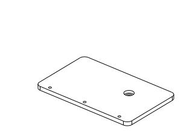
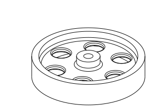
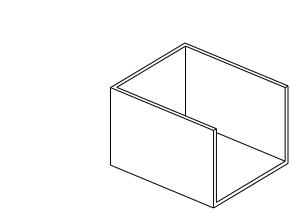
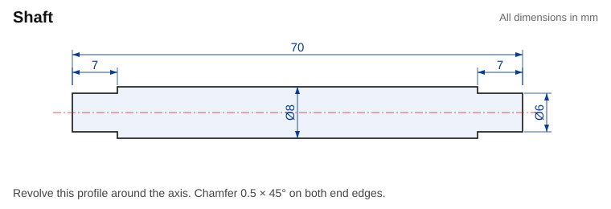
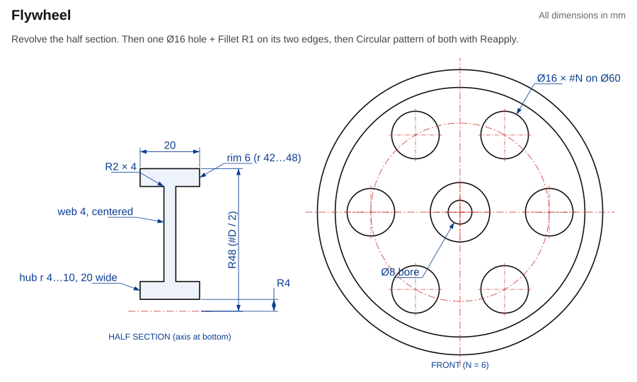
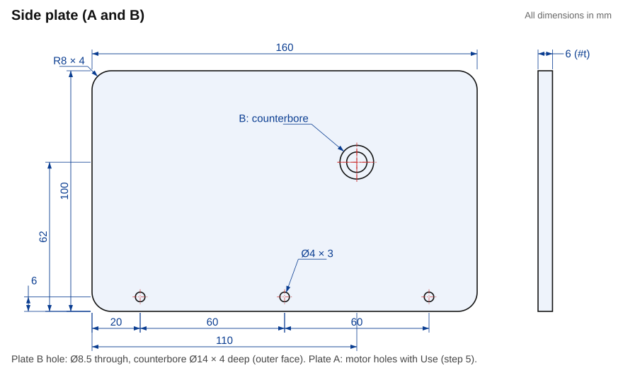
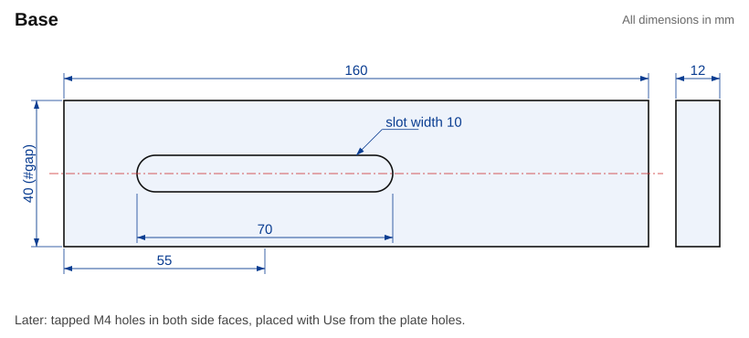
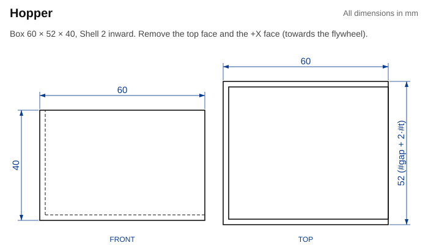
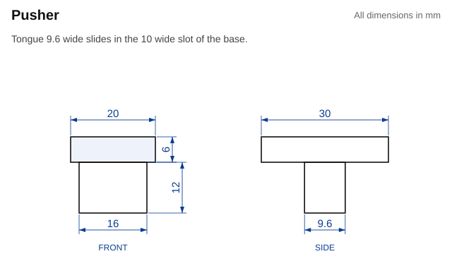

# Advanced: flywheel shooter module

A project for those who already know sketch, extrude, fillet and patterns. You build a small shooter module from 9 parts in one Part Studio, then put it together in an Assembly that actually moves.

**New topics:** Variables · Revolve · Plane · Mirror (parts) · Hole · Use (project edges) · Shell · Reapply · STEP import · Assembly: instances, mate connectors, Fastened / Revolute / Slider, Group.

{ width=260 } { width=260 } { width=260 }

## Rules

- One document: `Lastname - Shooter module`. One **Part Studio** for all parts, one **Assembly**.
- Model the parts **in place**: where they really sit in the module. Layout below.
- Every size that is marked `#name` on a drawing must come from a Variable, not a typed number.
- Check each part's **volume** (Mass properties) before moving on. ±1% is fine.

## Layout

All parts use one coordinate system: X along the module (0 … 160), Y across it, Z up.

| Part | Where it sits |
|---|---|
| Plate A | on the **Front** plane, Y = 0 … #t |
| Plate B | Mirror of plate A, Y = #t + #gap … 2·#t + #gap |
| Shaft, flywheel | axis along Y at X = 110, Z = 62; flywheel centered between the plates |
| Motor | outside plate A, on the same axis as the shaft |
| Base | between the plates, Z = 0 … 12 |
| Hopper | on top of both plates, X = 0 … 60, open side towards the flywheel |
| Hood | above the flywheel, on an angled plane |
| Pusher | in the base slot |
| Ball | anywhere in the hopper |

## Step 1 · Variables

Add a **Variable** feature for each, at the very top of the Feature list:

| Name | Value |
|---|---|
| `D` | 96 mm (flywheel diameter) |
| `N` | 6 (holes in the flywheel) |
| `gap` | 40 mm (between the plates) |
| `t` | 6 mm (plate thickness) |

## Step 2 · Shaft (Revolve)

Sketch the **half** profile on a plane through the axis, then **Revolve** it 360° around a construction line.

**Check:** 3 206 mm³.

## Step 3 · Flywheel (Revolve + Reapply)

1. Revolve the half section. Rim radius = `#D / 2`. Put the four R2 fillets **in the sketch** (sketch fillet), not as 3D fillets.
2. One Ø16 hole through the web (Extrude Remove).
3. **Fillet R1** on both edges of that one hole.
4. **Circular pattern → Feature pattern** of the hole **and** the fillet, count `#N`, **Reapply features** on.

**Check:** 55 720 mm³ (N = 6). Then test it:

| Change | Volume |
|---|---|
| `N = 8` | 54 067 mm³ |
| `N = 6`, `D = 100 mm` | 59 411 mm³ |

The model must rebuild with no red features. Set it back to `D = 96`, `N = 6`.

??? question "Why does D = 90 break it?"
    Try it. With D = 90 the rim's inner fillet reaches the holes, and the hole edges stop being simple circles. Think about which number should depend on `#D` so it never happens. (Not required, but a good question for the design review.)

## Step 4 · Side plates (Plane, Mirror, Hole)

1. **Plate A** on the Front plane: outline, Extrude `#t`, Fillet R8, three Ø4 holes.
   **Check:** 95 444 mm³.
2. **Plane → Offset** from the inner face of plate A by `#gap / 2`. This is the middle plane of the module.
3. **Mirror** (part mirror) plate A across that plane: this is **plate B**. Rename both parts.
4. Sketch a **point** on the outer face of plate B at X = 110, Z = 62. Then **Hole** feature on that point: Counterbore, hole Ø8.5 through, counterbore Ø14 × 4 deep,.
   **Check plate B:** 94 715 mm³.

## Step 5 · Motor (STEP import + Use)

1. Download the **STEP** file of a goBILDA 5203 Yellow Jacket motor from its product page on gobilda.com.
2. In your document: **+** (bottom left) → **Import** → choose the file. The motor becomes its own tab.
   In your Part Studio, use **Derived** to bring the motor part in.
3. Move it with **Transform** so its shaft is on the flywheel axis and its face touches the **outer** face of plate A.
4. Sketch on the outer face of plate A. Click **Use** (++u++) and select the motor's mounting edges: the boss circle and the screw holes. They are projected into your sketch and stay linked to the motor.
5. **Extrude → Remove** through plate A only.

No volume check here: it depends on the motor model. Check instead that the holes in plate A line up exactly with the motor.

## Step 6 · Base (Use + Hole)

1. Model the base between the plates: 160 × `#gap` × 12, slot 70 × 10.
   **Check:** 68 658 mm³ (before the tapped holes).
2. Sketch on a side face of the base (the face that touches a plate). **Use** the three Ø4 hole edges of the plate, add a **point** at the center of each projected circle.
3. **Hole** feature → **Tapped**, M4, depth 10, on those points. Do the same on the other side.

## Step 7 · Hopper (Shell)

Box 60 × 52 × 40 on top of both plates, then **Shell**, thickness 2, inward, removing the **top** face and the face **towards the flywheel**.

**Check:** 19 008 mm³.

## Step 8 · Hood (Plane at an angle)

1. **Plane → Line angle**: select the top edge of the hopper on its open side, angle 30°, so the plane tilts down towards the flywheel.
2. Sketch on it: rectangle 60 × `#gap`, centered between the plates.
3. Extrude 2.

**Check:** 4 800 mm³. Make sure it doesn't hit the flywheel: if it does, change the angle, not the flywheel.

## Step 9 · Pusher and ball

- **Pusher:** sits on the base, the tongue goes into the slot. **Check:** 5 443 mm³.
- **Ball Ø40:** Revolve a half circle. **Check:** 33 510 mm³.

## Step 10 · Assembly

1. Create an **Assembly** tab. **Insert** → your Part Studio → insert **all parts** (they keep the positions from the Part Studio; the derived motor comes too).
2. Right-click the base → **Fix**.
3. **Group**: plates A and B, base, hopper and hood. They now move as one rigid frame.
4. **Mate connectors**: add your own where Onshape can't find a good point, e.g. at the center of the hub of the flywheel.
5. Mates:

| Mate | Between | What it allows |
|---|---|---|
| Fastened | motor ↔ plate A | nothing |
| Revolute | shaft ↔ counterbore in plate B | spin around the axis |
| Fastened | flywheel ↔ shaft | flywheel spins with the shaft |
| Slider | pusher ↔ base slot | slide along the slot only, **limits 0 … 50 mm** |

## Check your assembly

- [ ] Drag the flywheel: it spins, the shaft spins with it, nothing else moves.
- [ ] Drag the pusher: it only slides along the slot and stops at both limits.
- [ ] Drag the frame: it doesn't move (fixed).
- [ ] Change `N` to 8 in the Part Studio, go back to the Assembly: it updates, no broken mates.
- [ ] **BOM** (the table icon on the right of the Assembly): 9 parts + motor, with the right names.

## Submit

Share the document with the coach (Can view) and post in the chat: the volume of every part and a short screen recording of the flywheel spinning and the pusher sliding.
