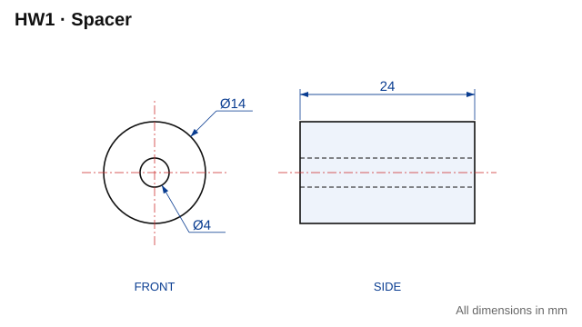
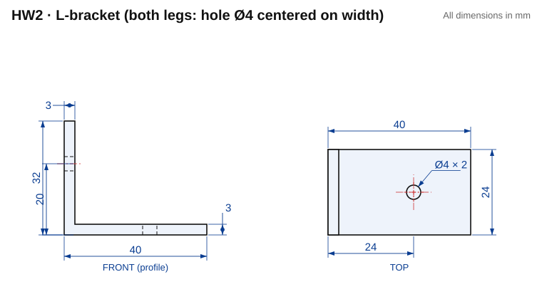
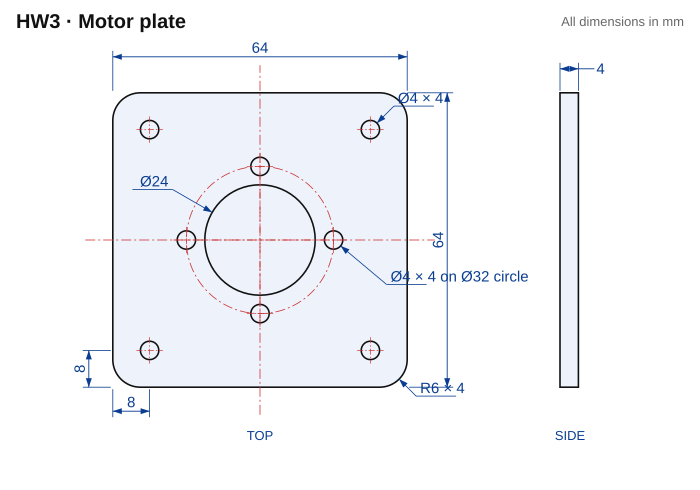
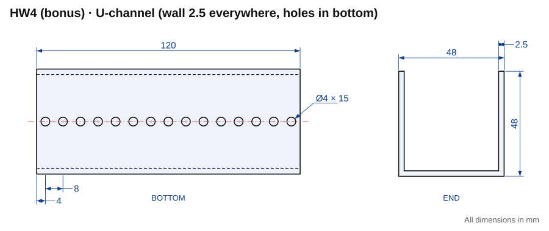
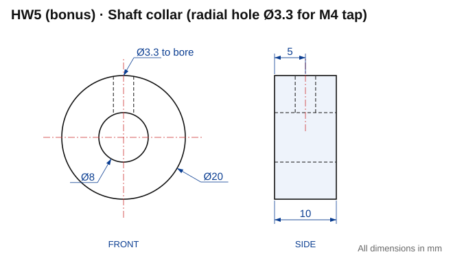

# Homework 1

Model each part from its drawing, one Onshape document per part. Assign **Aluminum - 6061** and check the volume in **Mass properties** before you submit. Then [submit](submit.md) the links.

HW1–HW3 are for everyone. Bonus parts are for those who have used CAD before, or who finished early.

| Part | Volume, mm³ | Mass, g (Al 6061) |
|---|---|---|
| HW1 Spacer | 3 393 | 9.2 |
| HW2 L-bracket | 4 893 | 13.2 |
| HW3 Motor plate | 14 049 | 37.9 |
| HW4 bonus U-channel | 41 229 | 111.3 |
| HW5 bonus Shaft collar | 2 587 | 7.0 |

Volume within ±1% counts as correct. Mass can differ a little if the material library uses a different density, so trust the volume.

## HW1 · Spacer

??? tip "Hint"
    One sketch with two circles on the same center. Extrude selects the ring between them, so the hole comes for free.

## HW2 · L-bracket

??? tip "Hint"
    Sketch the L profile on the **Front** plane, not Top. Then extrude it `24`, using **Symmetric** so the part stays centered. Add the holes with sketches on the outer face of each leg.

## HW3 · Motor plate

??? tip "Hint"
    Make one Ø4 hole on the Ø32 circle, then use **Circular pattern** around the center axis, count `4`. Corner holes: one hole plus a linear pattern in two directions, like in the lesson.

## HW4 (bonus) · U-channel

This is what a real goBILDA U-channel looks like, simplified.

??? tip "Hint"
    Either sketch the U profile and extrude 120, or extrude a 48×48 block and use **Shell** with thickness 2.5. Try both: which is easier to change later?

## HW5 (bonus) · Shaft collar

??? tip "Hint"
    Try the **Hole** feature for the radial hole. It needs a sketch point on a plane through the center. You may need a new plane: **Plane** → offset from a face, or through a line.
