# Homework 1

Model each part from its drawing, one Onshape document per part: `Lastname - T25 - Grid plate`. When it is done, check it against the drawing and submit a screenshot in the box under the task (sign in with the name and password from the coach).

| # | Part | Topics |
|---|---|---|
| [T25](#t25) | Grid plate with center window | linear pattern, skip instances, fillet, remove |
| [T26](#t26) | Rocker arm (one sketch) | one sketch, tangent, mirror in sketch, circular + linear pattern in sketch |
| [T29](#t29) | Hex pocket plate | one sketch, polygon, two staggered linear patterns |
| [T32](#t32) | Truss rail | one sketch, two linear patterns, mirror in sketch |
| [T33](#t33) | Keyhole plate | one sketch, trim, 2-direction pattern in sketch |
| [T34](#t34) | Triangle gusset with holes | one sketch, pattern + delete instances, fillet in sketch |

## T25 · Grid plate with center window {#t25}

*linear pattern, skip instances, fillet, remove*

Same 8 mm grid as T12, but the 9 holes in the middle are replaced by a 20 × 20 window. Hint: pattern the holes, then use **Skip instances** in the pattern, or cut the window and delete the extra holes.

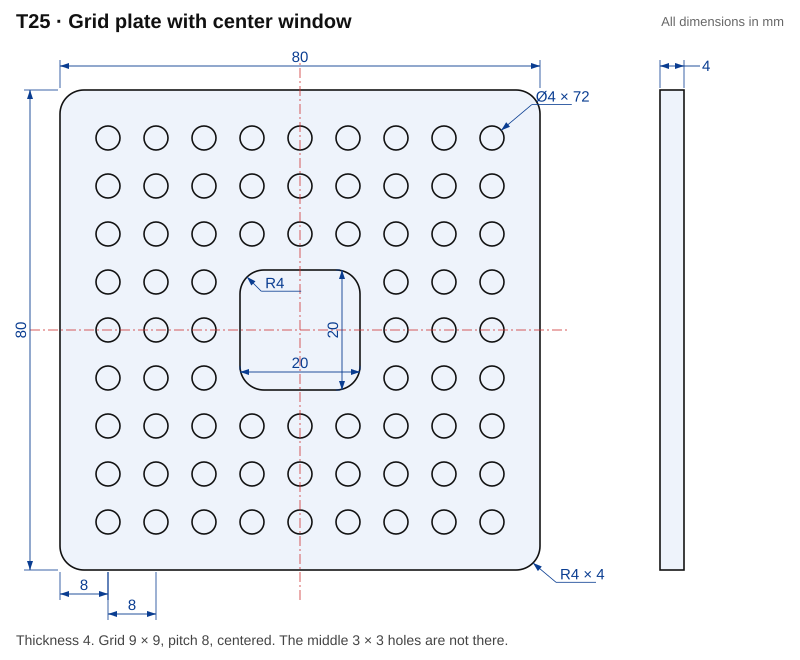

??? note "3D view"
    
    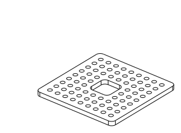

## T26 · Rocker arm (one sketch) {#t26}

*one sketch, tangent, mirror in sketch, circular + linear pattern in sketch*

Rule: **one sketch, one Extrude**. Everything (outline and all holes) must be in a single fully defined sketch. Draw the top tangent line once and use the sketch **Mirror** about a construction centerline; use the sketch **Circular pattern** and **Linear pattern** tools for the holes.

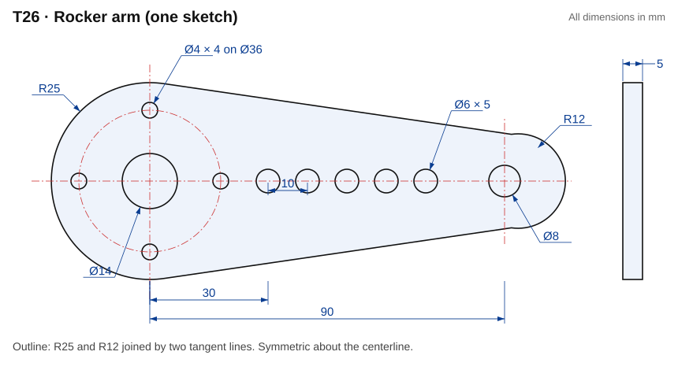

??? note "3D view"
    
    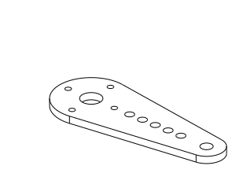

## T29 · Hex pocket plate {#t29}

*one sketch, polygon, two staggered linear patterns*

Rule: **one sketch, one Extrude**. Everything in a single fully defined sketch. Two patterns: one row of 7 and two rows of 6, shifted by half a step.

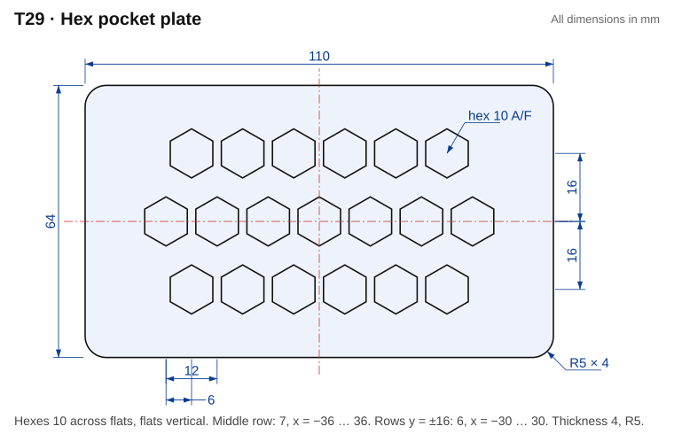

??? note "3D view"
    
    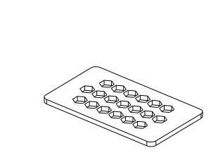

## T32 · Truss rail {#t32}

*one sketch, two linear patterns, mirror in sketch*

Rule: **one sketch, one Extrude**. Everything in a single fully defined sketch. Triangles pointing up and down: two linear patterns, shifted by half a step.

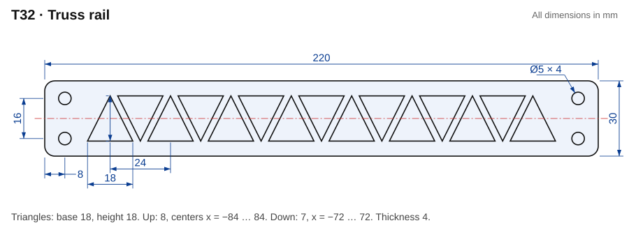

??? note "3D view"
    
    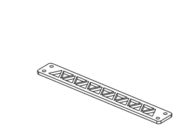

## T33 · Keyhole plate {#t33}

*one sketch, trim, 2-direction pattern in sketch*

Rule: **one sketch, one Extrude**. Everything in a single fully defined sketch. Each keyhole is a circle plus a slot: trim the lines inside so one closed outline is left.

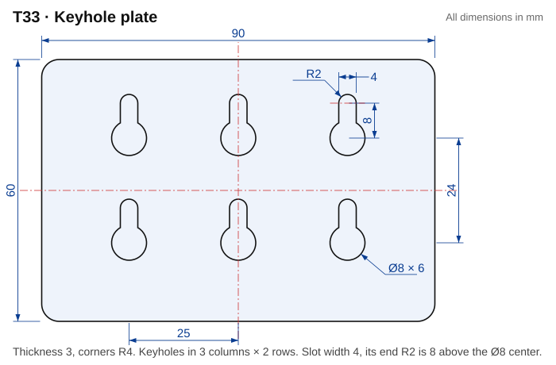

??? note "3D view"
    
    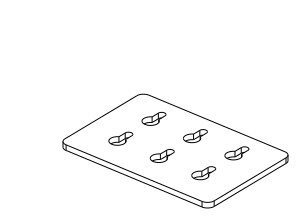

## T34 · Triangle gusset with holes {#t34}

*one sketch, pattern + delete instances, fillet in sketch*

Rule: **one sketch, one Extrude**. Everything in a single fully defined sketch. Pattern the holes in 2 directions, then remove the ones that fall outside the triangle.

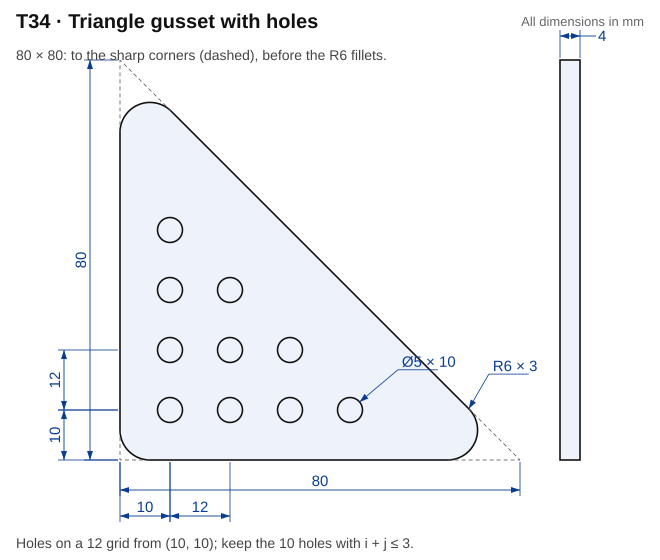

??? note "3D view"
    
    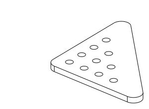

