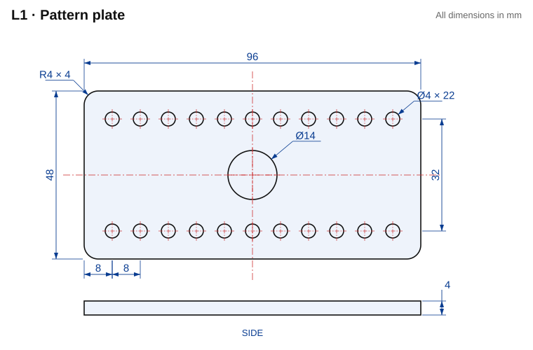

# Lesson 1: Sketch and part

**Goal:** build this plate from scratch and check it against the drawing. This is a simplified goBILDA-style pattern plate: holes Ø4 on an 8 mm grid, the same grid every goBILDA part uses.

## 1. Create a document and set units

Reference: [Interface](reference/basics/interface.md) · [Units](reference/basics/units.md)

1. On the Onshape home page click **Create → Document**, name it `Lastname - L1 - Plate`.
2. Open the document menu (☰, top left) → **Workspace units** → Length **Millimeter**, Mass **Gram**.

You are in a **Part Studio**, where parts are modeled. The left panel is the **Feature list**: every operation is saved there as a step. You can go back and edit any step later, and everything after it updates. This is the main idea of parametric CAD.

<!-- SCREENSHOT: Part Studio with Feature list, toolbar and view cube labeled -->

## 2. Move around

Reference: [Navigation and shortcuts](reference/basics/navigation.md)

| Action | How |
|---|---|
| Rotate | right mouse button drag |
| Pan | middle button drag, or ++ctrl++ + right button drag |
| Zoom | scroll |
| Fit everything on screen | ++f++ |
| Look straight at a face or plane | click that side of the view cube, or select the face and press ++n++ |

## 3. Sketch the outline

Reference: [Rectangle](reference/sketch/rectangle.md) · [Dimensions](reference/sketch/dimensions.md) · [Constraints](reference/sketch/constraints.md)

A **sketch** is a 2D drawing on a plane. Most 3D features start from one.

1. Click **Sketch** (++shift+s++), then click the **Top** plane.
2. Pick **Center point rectangle** and click on the origin, then anywhere to finish.
3. Pick **Dimension** (++d++). Click the top edge, place the number, type `96`. Click the left edge, type `48`.

Watch the colors:

- **Blue** lines can still move: the sketch is *under-defined*.
- **Black** lines are fixed: the sketch is *fully defined*.

Always aim for a fully defined sketch. If something is blue, it can change by accident later.

4. Click the green ✔ to close the sketch.

<!-- SCREENSHOT: fully defined 96x48 rectangle, black -->

## 4. Extrude

Reference: [Extrude](reference/part/extrude.md)

1. Click **Extrude** (++shift+e++), select the sketch region.
2. Depth `4`. Click ✔.

You now have a part. It shows up in the **Parts** list at the bottom of the Feature list.

## 5. Center hole

Reference: [Circle](reference/sketch/circle.md)

1. New sketch on the **top face** of the plate.
2. **Center point circle** (++c++) on the origin. Dimension it `14`. (Onshape shows diameter by default.)
3. Close the sketch. **Extrude** → choose **Remove** at the top of the dialog → End type **Through all**. ✔

## 6. One small hole, then a pattern

Reference: [Linear pattern](reference/part/linear-pattern.md)

Drawing 22 holes by hand is slow and easy to get wrong. Draw one, then copy it with a pattern.

1. New sketch on the top face. Circle anywhere in the top-left area, diameter `4`.
2. Place it with dimensions: from the circle center to the left edge `8`, from the center to the horizontal line through the origin `16`. Tip: you can select the origin or an edge as the other end of a dimension.
3. Close the sketch. Extrude → **Remove** → **Through all**.
4. Click **Linear pattern**. Type **Feature pattern**. Select the hole extrude in the Feature list.
5. Direction: click a long edge of the plate. Distance `8`, count `11`. Flip the arrow if it goes off the plate.
6. Tick **Second direction**: click a short edge, distance `32`, count `2`. ✔

<!-- SCREENSHOT: Linear pattern dialog with both directions filled -->

!!! tip "Why a feature pattern?"
    If you later change the first hole to Ø5, all 22 holes change. That's the whole point of keeping a model parametric.

## 7. Round the corners

Reference: [Fillet](reference/part/fillet.md)

1. **Fillet** (++shift+f++). Select the 4 vertical corner edges. Radius `4`. ✔

## 8. Check

Compare your part with the drawing: number of holes, diameters, thickness, fillets. Wrong hole count, wrong diameter or wrong depth are the usual mistakes.

## 9. If you finish early

- Rename the part (double-click it in the Parts list) to `Pattern plate`.
- Go back to the first sketch, change `96` to `112`. What happens? Change it back. Did anything break? Why?
- Start [Homework 1](homework-1.md).

## Words to remember

| Term | Meaning |
|---|---|
| Sketch | 2D drawing on a plane or flat face |
| Constraint | A rule in a sketch: horizontal, coincident, equal, tangent… |
| Dimension | A number that fixes a size or a distance |
| Fully defined | Nothing in the sketch can move; lines are black |
| Feature | One step in the Feature list: extrude, fillet, pattern… |
| Part Studio | Where you model parts |
