# Lesson 2: Sketch in depth

Last time we drew sketches and extruded them. Today: how a sketch really works, so it never turns blue or breaks when you change a number.

## 1. One shape, several ways to draw it

Almost every tool has options. Pick the one that needs **fewer constraints later**.

| Tool | Options | When it helps |
|---|---|---|
| Rectangle | **Corner** (2 points) · **Center point** · **Aligned / 3 points** (tilted) | Center point: symmetric part around the origin, no extra constraints |
| Circle | **Center point** · **3 point** | 3 point: a circle through three existing points |
| Arc | **3 point** · **Tangent** · **Center point** | Tangent arc: continues a line smoothly, the tangency is added for you |
| Polygon | **Inscribed** (vertices on the circle) · **Circumscribed** (circle touches the sides) | Circumscribed Ø10 hexagon = **10 across flats**, the size of a wrench or hex shaft |

## 2. Constraints and degrees of freedom

### The idea

Every piece of a sketch can move. A **degree of freedom (DOF)** is one way it can still move.

| Element | DOF | Why |
|---|---|---|
| Point | 2 | can move in x and in y |
| Circle | 3 | center x, center y, radius |
| Line | 4 | two end points × 2 |

Every **constraint** or **dimension** removes some of these. When nothing is left, the sketch is **fully defined** and turns **black**.

Example: a circle (3 DOF). *Coincident* center to the origin removes 2, a *diameter* removes the last one. Black.

Why care? If something is still blue, it can move when you change something else, and your part changes in a way you didn't plan.

### The constraints

| Constraint | What it does | Must know |
|---|---|---|
| **Coincident** | point on point, or point on a line/curve | ✔ |
| **Concentric** | two circles/arcs share a center | ✔ |
| **Tangent** | line or arc touches a circle smoothly | ✔ |
| **Perpendicular** | 90° between two lines | ✔ |
| **Equal** | same length or same radius | ✔ |
| **Midpoint** | a point sits in the middle of a line | ✔ |
| **Symmetric** | two points (or lines) are mirror images about a line | ✔ |
| Horizontal / Vertical | line is horizontal / vertical, or two points line up | |
| Parallel | two lines parallel | |
| Normal | a line is perpendicular to a curve at the point where they meet | |
| Fix | locks an element where it is. Avoid: use real constraints instead | |

### Symmetric

Select **two points** (or two lines), then the **axis** (a construction line). Onshape keeps them as mirror images about that axis. One dimension between them then fixes both sides at once.

Typical use: a part centered on the origin. Draw a vertical construction line through the origin, make the left and right edges symmetric about it, and put **one** width dimension, instead of two distances from the origin.

!!! tip
    Hold ++shift++ while drawing to stop Onshape from adding constraints by itself. Click any constraint icon and press ++delete++ to remove it.

### Practice: minimum dimensions

Make each sketch **fully defined (black)** using **no more dimensions than the target**. Everything else must come from constraints. The drawings show all the sizes; your job is to need as few of them as possible.

#### Rounded rectangle

Target: **3 dimensions**. Centered on the origin.

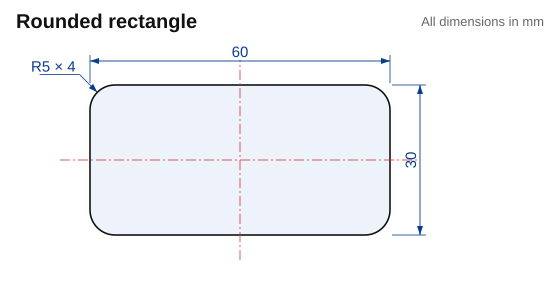

??? note "3D view"
    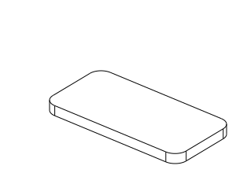

#### Square with 4 holes

Target: **3 dimensions**. Hint: a construction square through the hole centers, and Equal.

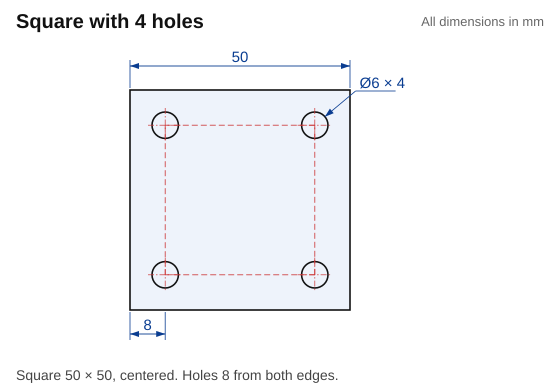

??? note "3D view"
    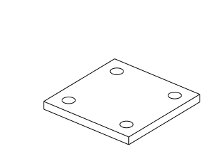

#### Hex nut

Target: **2 dimensions**. Which polygon option gives "across flats" directly?

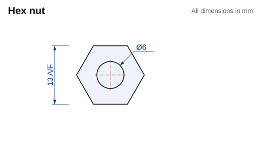

??? note "3D view"
    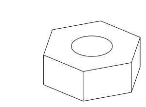

#### Cam (two circles + tangents)

Target: **3 dimensions**.

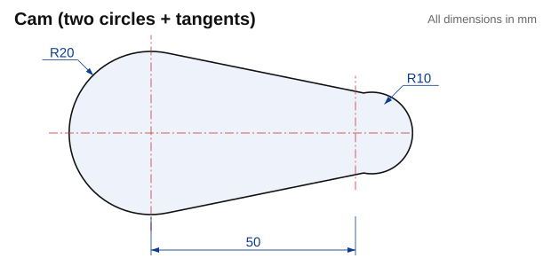

??? note "3D view"
    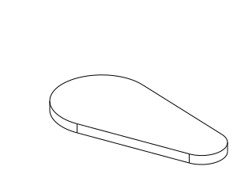

#### Trapezoid with a hole

Target: **4 dimensions**. The hole is in the middle of the height, on the axis (Midpoint, Symmetric).

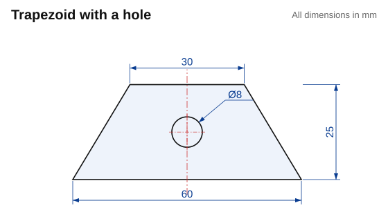

??? note "3D view"
    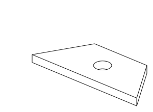

#### Slotted bar with 3 holes

Target: **3 dimensions**. End holes are concentric with the slot ends; the middle one sits at the midpoint.

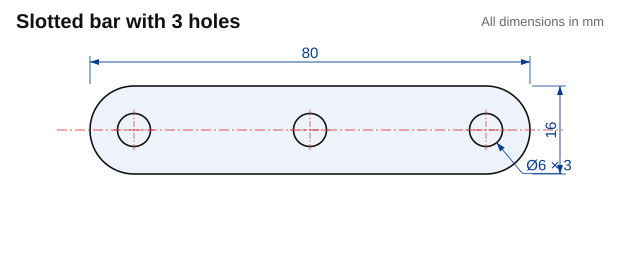

??? note "3D view"
    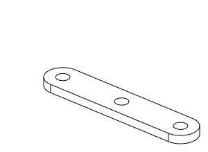

## 3. Editing tools

| Tool | What it does |
|---|---|
| **Trim** | Click a piece of a line or curve: it is cut back to the nearest intersections. Drag over many pieces to trim them all. |
| Extend | Lengthens a line or arc until it hits the next one. |
| Split | Cuts a line or curve into two at a point, without removing anything. |
| **Fillet / Chamfer in the sketch** | Rounds or cuts a sketch corner. Unlike a 3D fillet it lives in the sketch, so it can't break when the edges change (remember the wheel with N spokes). |
| **Mirror** | Copies selected geometry across a line. Needs a line to mirror about, usually a construction line. |
| **Circular pattern** | Copies geometry around a point, N times. |
| **Offset** | Makes a copy of a chain of curves at a fixed distance. Great for walls, frames and slots. |

### Examples

#### Mirror: bracket

Draw the **right half** only, then sketch **Mirror** about a vertical construction line through the origin.

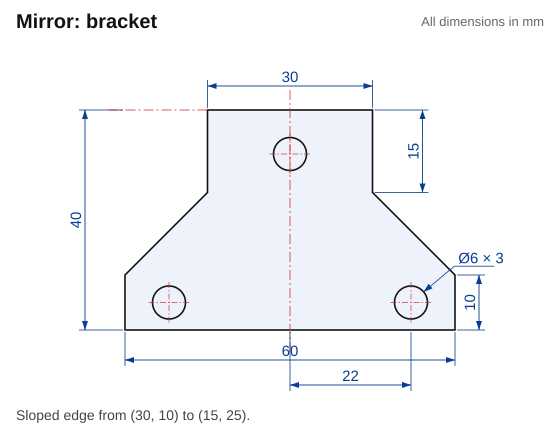

??? note "3D view"
    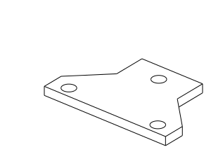

**Check:** volume = **6 561 mm³**.

#### Circular pattern: flange with notches

Two sketch circular patterns: 6 holes, and 6 notches on the rim shifted by 30°.

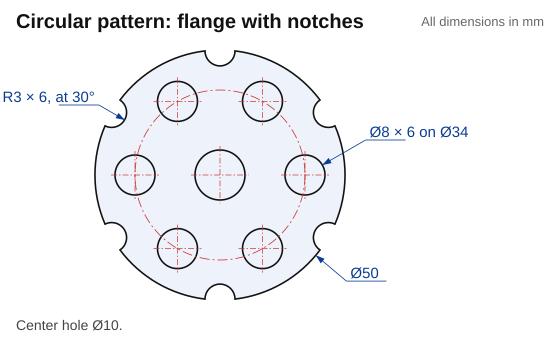

??? note "3D view"
    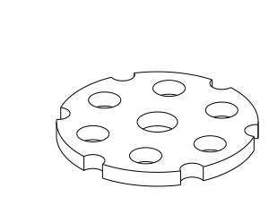

**Check:** volume = **6 003 mm³**.

#### Offset: frame

Draw the outer outline, then **Offset** it 5 inward. Extrude the region between the two outlines.

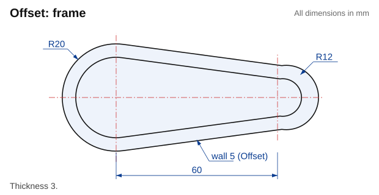

??? note "3D view"
    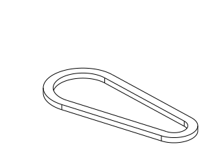

**Check:** volume = **3 088 mm³**.

## 4. Two models for the lesson

We build these together, step by step. Plan the sketch before drawing: what is symmetric, what is concentric, what can be a pattern.

### Intake arm plate

Uses: tangent, Mirror, polygon (circumscribed), circular pattern, Offset, Trim, sketch fillet. One sketch, Extrude 5.

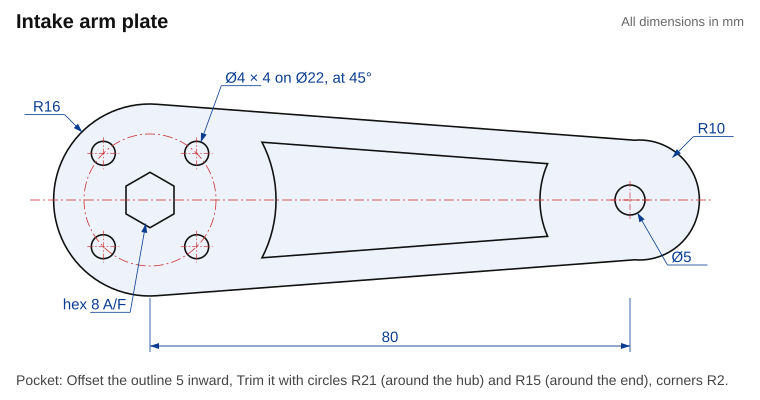

??? note "3D view"
    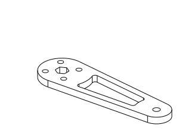

**Check:** volume = **9 109 mm³**.

### Adjustable motor mount

Uses: center rectangle, sketch chamfer, concentric, arc + Offset for slots, circular pattern, Symmetric. One sketch, Extrude 4.

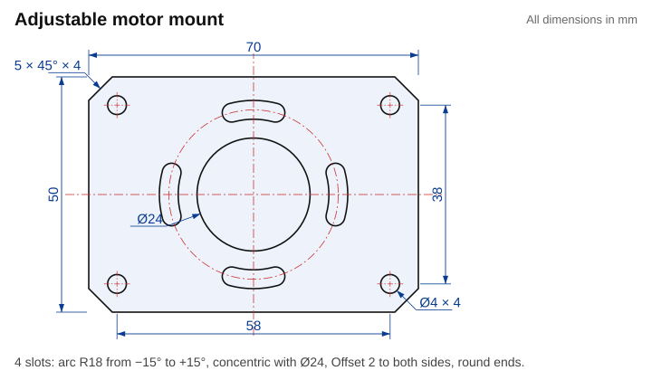

??? note "3D view"
    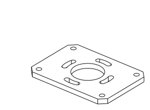

**Check:** volume = **10 985 mm³**.

## 5. On your own

[Practice](practice.md), Level 6: **T26, T27, T28, T33**. If you finish: T29–T32.
