# Lesson 3: From sketch to parts

A sketch is flat. Today: how it becomes solid parts, how parts interact, and how to make the model update itself when a size changes.

## 1. Extrude in depth

### End types

| End type | What it does | Use it when |
|---|---|---|
| **Blind** | a typed depth | the depth is a real size of the part |
| **Symmetric** | the depth is split to both sides of the sketch plane | the sketch is on the middle plane |
| **Up to next** | stops at the next face it hits | a boss up to a wall, a cut through one wall only |
| **Up to face / part / vertex** | stops at a face, part or point you pick | it must always end exactly there |
| **Through all** | cuts through everything | holes, slots |

!!! tip "Rule of thumb"
    A cut that must go *through* the part should be **Through all** or **Up to next**, not a typed number. If the part gets thicker later, a typed depth stops halfway.

### More options

- **Second direction**: extrude to both sides by different amounts.
- **Thin**: extrude only the line, with a wall thickness. One open line becomes a channel or an angle.
- **One sketch, several features**: one sketch can feed several extrudes. Pick different regions each time.

## 2. Parts, bodies, features

### Words

| Word | Meaning |
|---|---|
| **Feature** | one step in the Feature list (sketch, extrude, fillet…) |
| **Part** | one solid, listed under **Parts** at the bottom of the Feature list |
| **Part Studio** | can hold **many parts**. A whole module can live in one Part Studio |

### New / Add / Remove / Intersect

Every Extrude (and Revolve, Sweep…) has these options at the top:

| Option | Result |
|---|---|
| **New** | a new separate part |
| **Add** | merged into existing parts (in **Merge scope**) |
| **Remove** | cuts from parts (in **Merge scope**) |
| **Intersect** | keeps only the overlap |

**Merge scope** decides *which* parts are affected. "Why do I suddenly have two parts?" means the feature was **New**, or the new shape doesn't touch the old one.

### Boolean

**Boolean** works on parts that already exist:

- **Union**: several parts → one.
- **Subtract**: cut the *tools* out of the *targets*. With **Keep tools** the tool part stays. This is how you make a hole that always fits a shaft.
- **Intersect**: keep only the common volume.

### Split

**Split** cuts a part into two with a plane or a face. A box becomes a base and a lid.

## 3. Where to sketch

- **Sketch on a face**: the sketch moves with that face. Change the thickness and the sketch goes along.
- **Sketch on a plane**: stays where the plane is.
- **Plane** feature: **Offset** from a plane or face, **Mid plane** between two faces, **Line angle** (through an edge, at an angle).
- **Use** (++u++ in a sketch): projects edges of another part into your sketch, linked. If the other part changes, your sketch follows.

## 4. 3D operations on parts

- **3D Fillet / Chamfer**: pick edges. **Tangent propagation** follows the chain of smooth edges. Order matters: fillets near holes are easier if you fillet first, then cut.
- **Patterns in 3D**: **Part pattern** copies whole parts, **Feature pattern** repeats features (with **Reapply** they are rebuilt at each place), **Face pattern** copies faces. **Mirror** has the same three options.
- **Revolve**: a half profile around an axis (shafts, wheels, spacers).

## 5. Practice

Numbers match the columns in the progress table (3.1 … 3.8).

| # | Part | Topics | Required |
|---|---|---|---|
| [L3-1](#l31) | Bearing blocks | Multiple parts, **Plane** (mid plane), **Mirror** of a part, **Boolean Subtract** with Keep tools. | ✔ |
| [L3-2](#l32) | Latch from two views | **Intersect** of two extrudes, **Through all**. | ✔ |
| [L3-3](#l33) | Electronics box | **Plane**, Remove from a plane, **Up to face**, **Split**, two parts. |  |
| [L3-4](#l34) | Bracket with variable thickness | **Variables**, **Up to next / Through all**, 3D **Fillet**, **Mirror** of a feature. | ✔ |
| [L3-5](#l35) | Thin channel | **Thin** extrude, sketch on a face. | ✔ |
| [L3-6](#l36) | Plate stack | Multiple parts, **Use**. |  |
| [L3-7](#l37) | Revolved hub | **Revolve**, 3D **Chamfer**, **Circular pattern** of a feature, **Up to next**. | ✔ |
| [L3-8](#l38) | Slide carriage | Two parts, **Use** + **Offset**, Remove **Through all**. |  |

### L3-1 · Bearing blocks required {#l31}

*Multiple parts, **Plane** (mid plane), **Mirror** of a part, **Boolean Subtract** with Keep tools.*

Shaft first (Revolve or Extrude, New). Then one block (New). Bore = **Boolean → Subtract**, target the block, tool the shaft, **Keep tools** ticked. Second block: **Mirror** the part across a mid plane. Change the shaft to Ø10: both bores must follow.

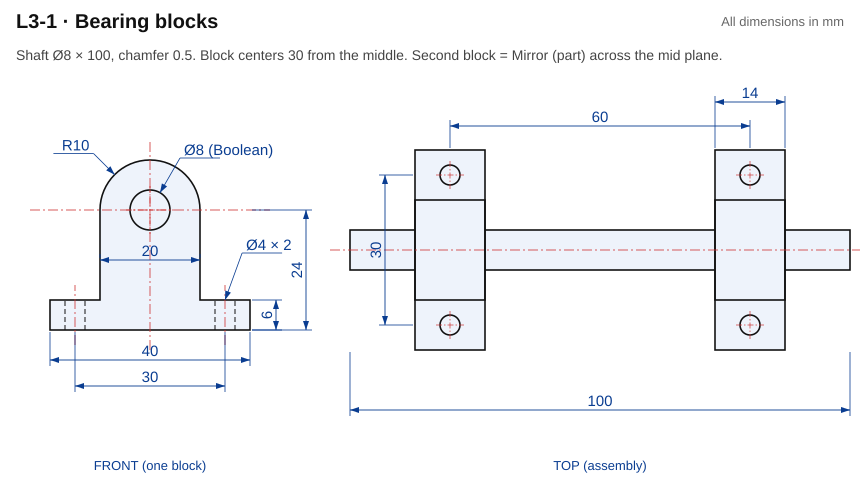

??? note "3D view"
    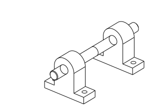

### L3-2 · Latch from two views required {#l32}

***Intersect** of two extrudes, **Through all**.*

The shape is hard to sketch in one view. Extrude the front view (New, symmetric), extrude the top view (New), then **Boolean → Intersect**. Then the Ø8 hole down and the Ø6 hole through the hook.

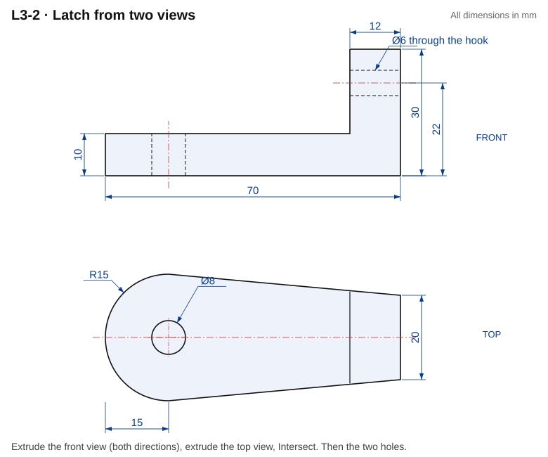

??? note "3D view"
    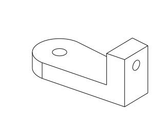

### L3-3 · Electronics box {#l33}

***Plane**, Remove from a plane, **Up to face**, **Split**, two parts.*

Solid box → hollow it from a **Plane** 2.5 below the top (Remove, depth 31) so the top stays closed. Bosses: sketch on the floor, Extrude Add **Up to face** (the ceiling). Holes Through all. Then a **Plane** at 30 and **Split**: base and lid.

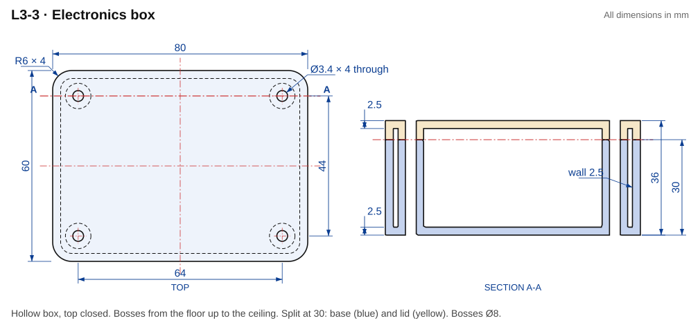

??? note "3D view"
    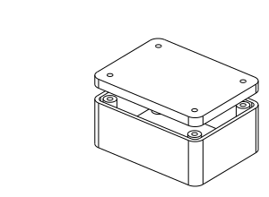

### L3-4 · Bracket with variable thickness required {#l34}

***Variables**, **Up to next / Through all**, 3D **Fillet**, **Mirror** of a feature.*

Make `t` a Variable. One gusset, then **Mirror** it. Inner bend: 3D fillet R4. All cuts Through all or Up to next. Then set `t = 6`: nothing may break.

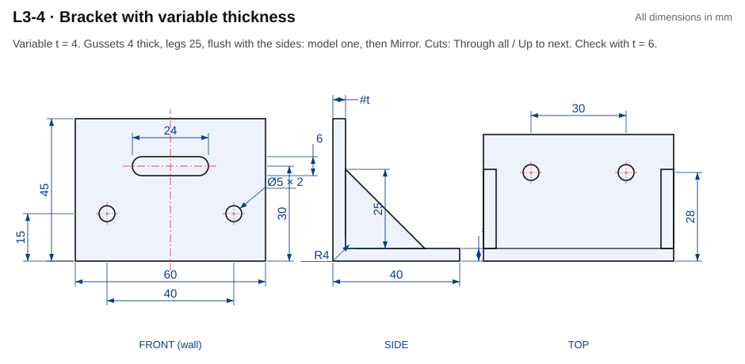

??? note "3D view"
    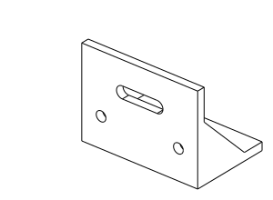

### L3-5 · Thin channel required {#l35}

***Thin** extrude, sketch on a face.*

Sketch only the U line, no thickness. Extrude with **Thin**, 2.5, to the inside. Holes with a sketch on the bottom face.

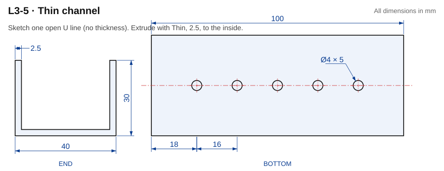

??? note "3D view"
    

### L3-6 · Plate stack {#l36}

*Multiple parts, **Use**.*

Base plate first. Standoffs: sketch on the top face of the base, **Use** the hole edges, draw Ø8 around them, Extrude **New** 20. Top plate: sketch on top of a standoff, **Use** the base outline and holes, Extrude **New** 4. Move a hole in the base: everything follows.

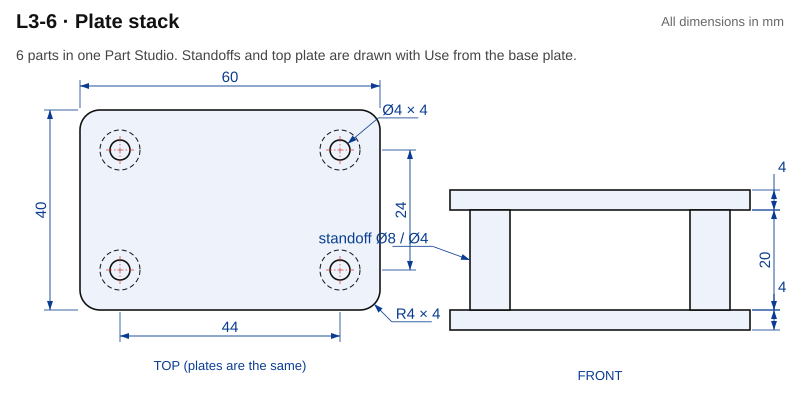

??? note "3D view"
    

### L3-7 · Revolved hub required {#l37}

***Revolve**, 3D **Chamfer**, **Circular pattern** of a feature, **Up to next**.*

Revolve the right half of the section. Chamfer the two outer top edges. One Ø5 hole + Circular pattern × 6. Radial Ø2.5 hole from a plane through the axis, **Up to next** so it goes through one wall only.

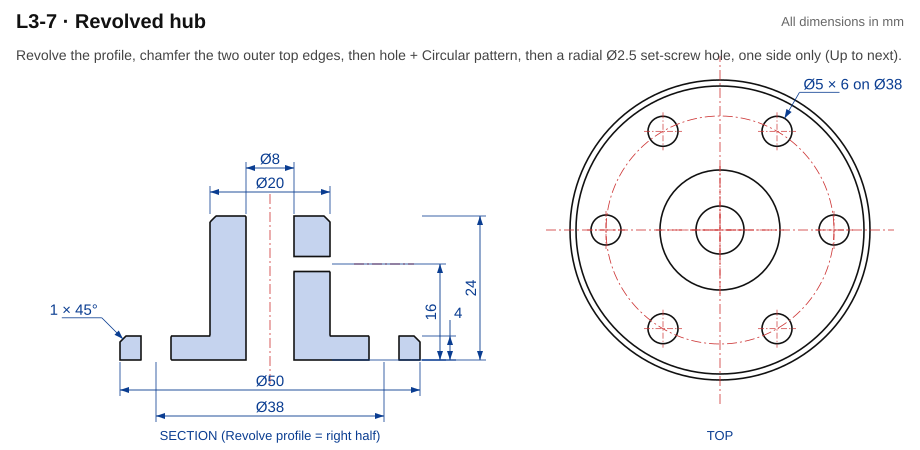

??? note "3D view"
    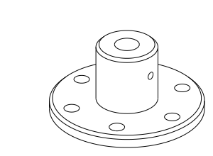

### L3-8 · Slide carriage {#l38}

*Two parts, **Use** + **Offset**, Remove **Through all**.*

Rail: extrude the T profile 120 (New). Carriage: block 40 × 36 × 22, 0.5 above the rail base (New). Channel: sketch on the carriage end face, **Use** the rail outline, **Offset** it 0.5 outward, Extrude Remove Through all, only from the carriage.

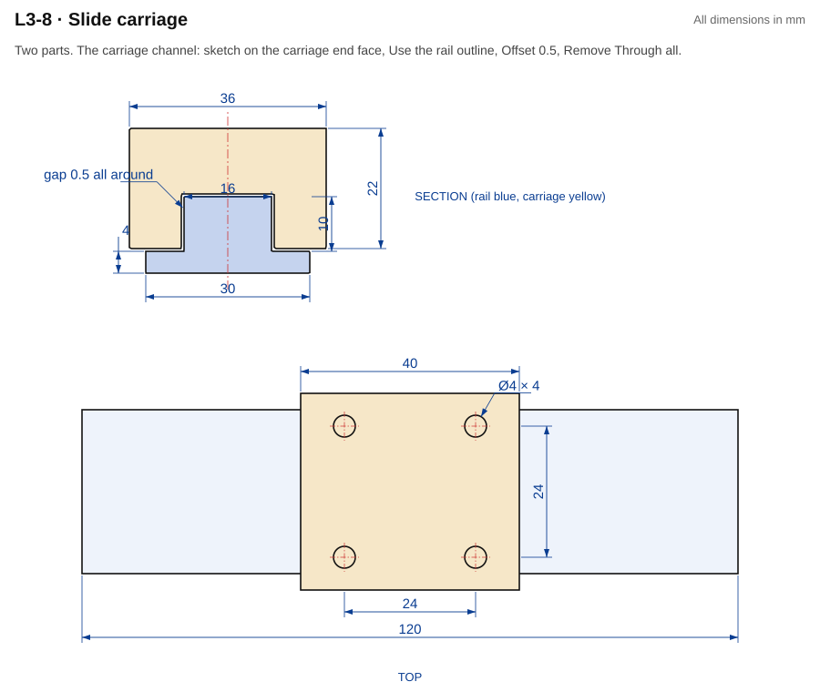

??? note "3D view"
    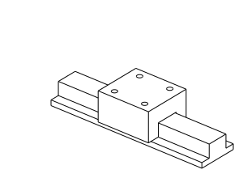

