# Lesson 3: From sketch to parts

A sketch is flat. Today: how it becomes solid parts, how parts interact, and how to make the model update itself when a size changes.

## 1. Extrude in depth

### End types

| End type | What it does | Use it when |
|---|---|---|
| **Blind** | a typed depth | the depth is a real size of the part |
| **Symmetric** | the depth is split to both sides of the sketch plane | the sketch is on the middle plane |
| **Up to next** | stops at the next face it hits | a boss up to a wall, a cut through one wall only |
| **Up to face / part / vertex** | stops at a face, part or point you pick | it must always end exactly there |
| **Through all** | cuts through everything | holes, slots |

!!! tip "Rule of thumb"
    A cut that must go *through* the part should be **Through all** or **Up to next**, not a typed number. If the part gets thicker later, a typed depth stops halfway.

### More options

- **Second direction**: extrude to both sides by different amounts.
- **Thin**: extrude only the line, with a wall thickness. One open line becomes a channel or an angle.
- **One sketch, several features**: one sketch can feed several extrudes. Pick different regions each time.

## 2. Parts, bodies, features

### Words

| Word | Meaning |
|---|---|
| **Feature** | one step in the Feature list (sketch, extrude, fillet…) |
| **Part** | one solid, listed under **Parts** at the bottom of the Feature list |
| **Part Studio** | can hold **many parts**. A whole module can live in one Part Studio |

### New / Add / Remove / Intersect

Every Extrude (and Revolve, Sweep…) has these options at the top:

| Option | Result |
|---|---|
| **New** | a new separate part |
| **Add** | merged into existing parts (in **Merge scope**) |
| **Remove** | cuts from parts (in **Merge scope**) |
| **Intersect** | keeps only the overlap |

**Merge scope** decides *which* parts are affected. "Why do I suddenly have two parts?" means the feature was **New**, or the new shape doesn't touch the old one.

### Boolean

**Boolean** works on parts that already exist:

- **Union**: several parts → one.
- **Subtract**: cut the *tools* out of the *targets*. With **Keep tools** the tool part stays. This is how you make a hole that always fits a shaft.
- **Intersect**: keep only the common volume.

### Split

**Split** cuts a part into two with a plane or a face. A box becomes a base and a lid.

## 3. Where to sketch

- **Sketch on a face**: the sketch moves with that face. Change the thickness and the sketch goes along.
- **Sketch on a plane**: stays where the plane is.
- **Plane** feature: **Offset** from a plane or face, **Mid plane** between two faces, **Line angle** (through an edge, at an angle).
- **Use** (++u++ in a sketch): projects edges of another part into your sketch, linked. If the other part changes, your sketch follows.

## 4. 3D operations on parts

- **3D Fillet / Chamfer**: pick edges. **Tangent propagation** follows the chain of smooth edges. Order matters: fillets near holes are easier if you fillet first, then cut.
- **Patterns in 3D**: **Part pattern** copies whole parts, **Feature pattern** repeats features (with **Reapply** they are rebuilt at each place), **Face pattern** copies faces. **Mirror** has the same three options.
- **Revolve**: a half profile around an axis (shafts, wheels, spacers).

## 5. Practice

### Shaft and bracket {#l31}

Boolean Subtract with **Keep tools**. Make the shaft first (New), then the bracket block around it (New, so it does not merge). Then **Boolean → Subtract**: target = bracket, tool = shaft, tick **Keep tools**. Change the shaft to Ø12: the hole must follow.

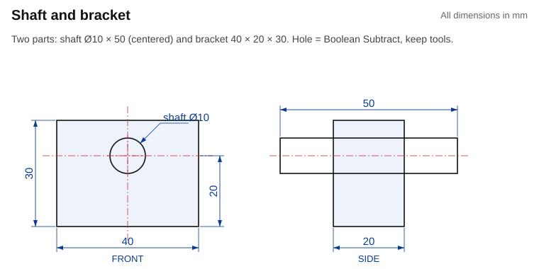

??? note "3D view"
    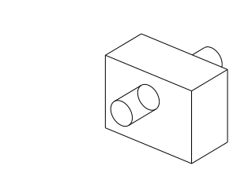

### Part from two views {#l32}

A shape that is hard to sketch directly. Extrude the front view (New), extrude the top view (New), then **Boolean → Intersect**. Only the volume inside both is left.

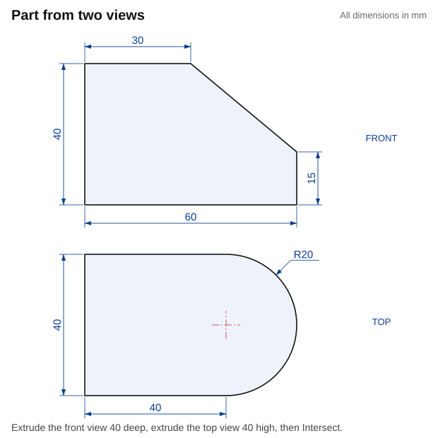

??? note "3D view"
    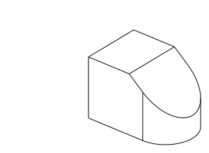

### Box with a lid {#l33}

Box 60 × 40 × 30, pocket with a 3 mm wall and 3 mm floor (Extrude Remove from a sketch on the top face). Then **Plane** offset 24 from the bottom and **Split** the box: you get a lid and a base, two parts.

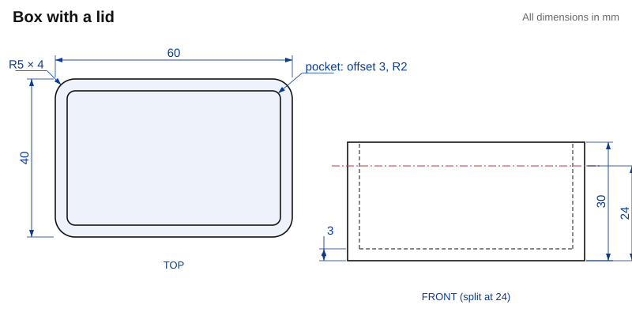

??? note "3D view"
    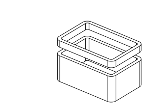

### Bracket with "up to" cuts {#l34}

Make `t` a **Variable** (4 mm). Holes and the slot are cut with **Through all** or **Up to next**. Then change `t` to 6: everything must still cut through.

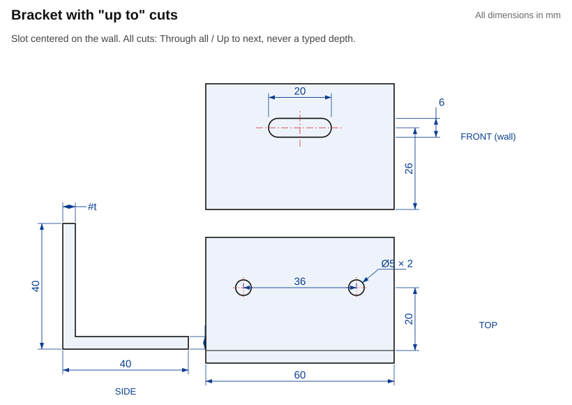

??? note "3D view"
    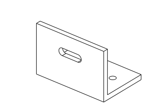

### Thin channel {#l35}

**Thin** extrude: sketch only the U line, no thickness. Holes in the bottom with a sketch on the bottom face.

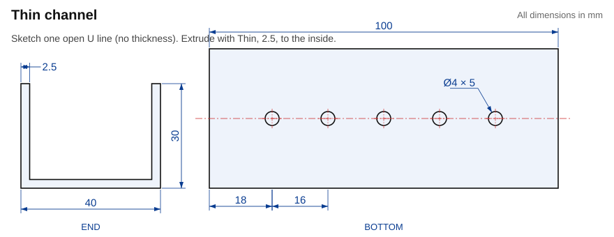

??? note "3D view"
    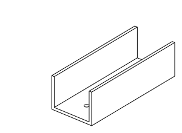

### Plate stack {#l36}

Several parts in one Part Studio, linked with **Use**. Base plate first. Standoffs: sketch on the top face of the base, **Use** the hole edges, draw Ø8 around them, Extrude **New** 20. Top plate: sketch on top of a standoff, **Use** the base outline and holes, Extrude **New** 4. Change a hole position in the base: everything follows.

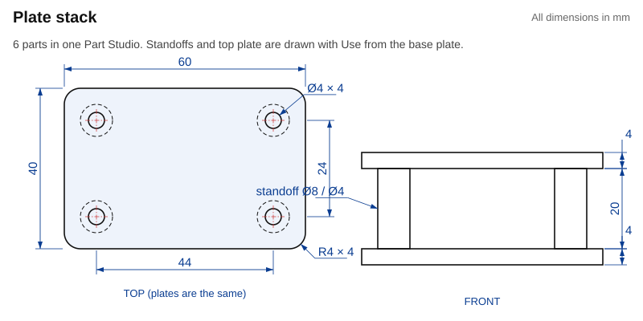

??? note "3D view"
    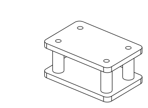

