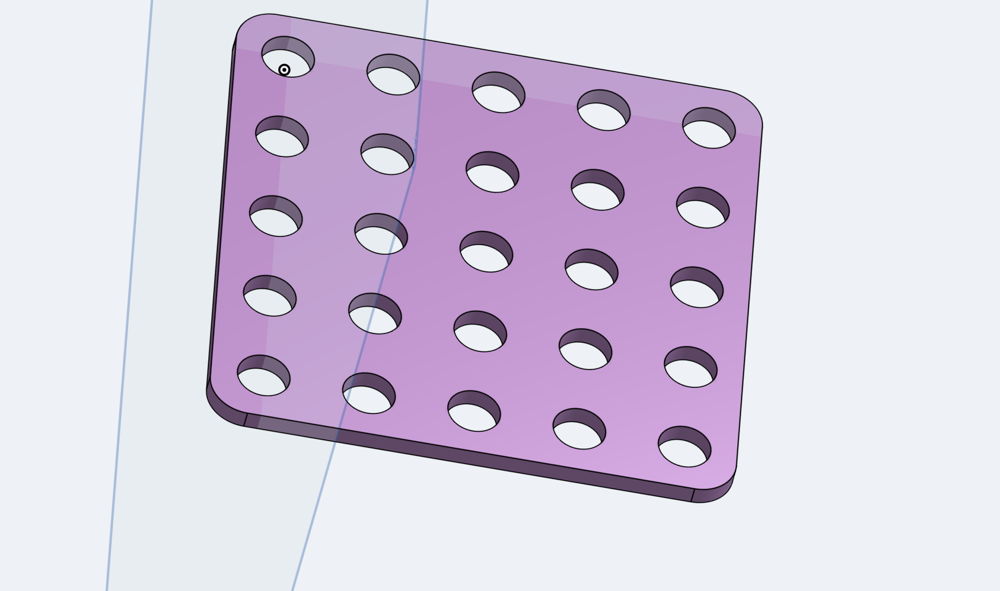
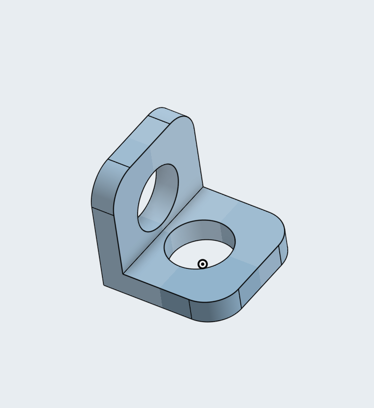

# Lesson 4: Assemblies

Until now every part lived in a Part Studio. Today we put parts together in an **Assembly** — the way the team robot will be built.

## 1. Variables and configurations (overview)

Reference: [Variables](reference/params/variables.md) · [Configurations](reference/params/configurations.md)

The kit plate below can be any size. It is built with variables:

- `#N`, `#M` — number of holes along each side.
- The plate size is an expression of `#N` and `#M`, and the hole pattern uses them as counts.
- A **Configuration** turns these values into a choice in a list: pick a size and the part rebuilds.

You don't have to build this yourself today — just understand how it works. You will use the plate in your assemblies.

{width=48%} {width=30%}

## 2. Versions — git inside Onshape

Reference: [Versions and History](reference/document/versions.md)

- **Version** — a saved snapshot of the document, like a commit.
- **History** — the list of all changes; you can open or restore an older state.
- A part from another document can be inserted only from a **Version**. When the author makes a new version, you get an **Update** button.

## 3. Team robot

Read the [Team robot](robot/index.md) page: your subassembly, your drawings, how to share your document and where to paste the link. Deadline — Thursday.

## 4. Assembly

Reference: [Insert](reference/assembly/insert.md) · [Fix](reference/assembly/fix.md) · [Mate connector](reference/assembly/mate-connector.md) · [Fastened](reference/assembly/fastened.md) · [Revolute](reference/assembly/revolute.md) · [Slider](reference/assembly/slider.md)

- **Insert → Other documents** — add the kit plate and bracket; choose the configuration when inserting.
- **Fix** the first part, so the assembly has a base.
- **Mate connector** — a point with axes, placed at a hole center or a face.
- **Fastened** — parts don't move relative to each other (bracket to plate).
- **Revolute** — rotation around one axis (two plates on one hole).
- **Slider** — movement along one axis.
- Several copies of one part; changing the configuration of a part that is already inserted.

## 5. Derived and STEP

Reference: [Derived](reference/document/derived.md) · [Import and Export](reference/document/import-export.md)

- **Derived** (in a Part Studio) — bring a part from another document to model around it, for example a bracket that fits the holes of the base.
- **Import / Export STEP** — exchange models with other CAD programs and manufacturers. Imported STEP is plain geometry without a feature tree.
- **Export STL** — for 3D printing.

## 6. Practice

Use the kit plate and bracket. Make a new document, insert the parts and build:

| # | Task | Mates |
|---|---|---|
| 4-1 | Frame: 4 plates + 4 brackets | Fastened |
| 4-2 | Open box: 5 plates + brackets | Fastened |
| 4-3 | Four-bar linkage: 4 long plates joined at the ends — drag it and watch it move | Revolute |
| 4-4 | Shelf or bridge: a long plate on two posts | Fastened |
| 4-5 | Free build — anything you like, send a screenshot | any |

At the end of the lesson make a **Version** of your team robot document.
