# Practice: 24 parts

Parts from drawings, from easy to hard. Each one uses a few topics from Lesson 1: **sketch, extrude (New / Add / Remove), parts and Boolean, fillet, chamfer, patterns (sketch / feature / face), mirror**.

- Do them in order. Levels 1–3 are for everyone, 4–5 when you feel confident.
- One Onshape document per part: `Lastname - T07 - Rounded block`.
- Check your answer: assign **Aluminum - 6061**, open **Mass properties**, compare the **volume**. Within ±1% counts as correct.
- Try to guess how you would build the part *before* opening the 3D view.

| # | Part | Topics | Volume, mm³ |
|---|---|---|---|
| [T01](#t01) | Washer | sketch, extrude | 528 |
| [T02](#t02) | Slotted plate | sketch, extrude, slot | 6 607 |
| [T03](#t03) | Gusset | sketch, constraints, extrude | 3 087 |
| [T04](#t04) | Hex standoff | sketch, polygon, extrude | 1 481 |
| [T05](#t05) | Stepped block | extrude New/Add/Remove, blind depth | 17 822 |
| [T06](#t06) | Tee bar | sketch on Front, extrude | 19 500 |
| [T07](#t07) | Rounded block | fillet, chamfer | 46 537 |
| [T08](#t08) | D-shaft | extrude, chamfer, remove | 5 400 |
| [T09](#t09) | Rounded L-bracket | sketch, extrude, fillet, holes | 4 917 |
| [T10](#t10) | Knob | extrude, fillet, chamfer, blind hole | 8 036 |
| [T11](#t11) | Bolt-circle flange | circular pattern, construction circle | 14 373 |
| [T12](#t12) | Grid plate | linear pattern (2 directions), fillet | 16 082 |
| [T13](#t13) | Lightening plate | sketch pattern, fillet, remove | 11 620 |
| [T14](#t14) | Notched disk | circular pattern, remove | 8 740 |
| [T15](#t15) | Heat sink | extrude Add, feature pattern | 11 520 |
| [T16](#t16) | Pillow block | mirror, extrude Add, sketch on side face | 21 424 |
| [T17](#t17) | Fork | mirror, extrude Add, hole across | 20 348 |
| [T18](#t18) | Split clamp | remove, sketch on side face, slot | 13 251 |
| [T19](#t19) | Boolean: intersect | Boolean intersect, two parts | 42 667 |
| [T20](#t20) | goBILDA-style bracket | sheet-like L, fillet, linear pattern, mirror | 4 759 |
| [T21](#t21) | Spoked wheel, N spokes | variables, feature pattern, extrude Add | 39 118 |
| [T22](#t22) | Hex-bore pulley | stacked extrudes, polygon, circular pattern, chamfer | 12 434 |
| [T23](#t23) | Servo mount plate | sketch, chamfer, pattern, mirror | 10 125 |
| [T24](#t24) | Shooter side plate | everything: fillet, patterns, mirror, remove | 70 204 |

## Level 1 · Sketch and extrude

### T01 · Washer {#t01}

*sketch, extrude*

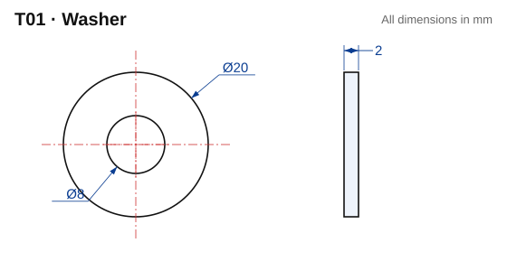

**Check:** volume = **528 mm³**

??? note "3D view"
    
    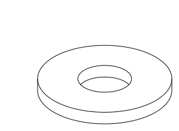

### T02 · Slotted plate {#t02}

*sketch, extrude, slot*

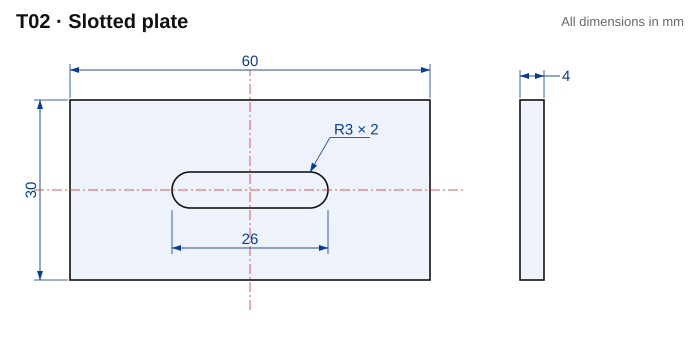

**Check:** volume = **6 607 mm³**

??? note "3D view"
    
    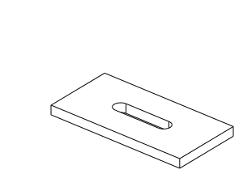

### T03 · Gusset {#t03}

*sketch, constraints, extrude*

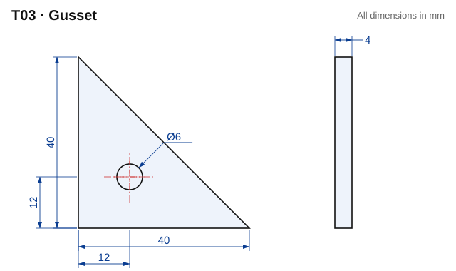

**Check:** volume = **3 087 mm³**

??? note "3D view"
    
    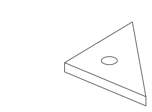

### T04 · Hex standoff {#t04}

*sketch, polygon, extrude*

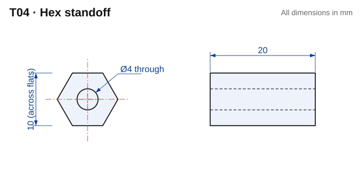

**Check:** volume = **1 481 mm³**

??? note "3D view"
    
    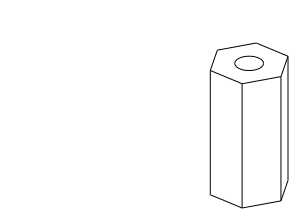

### T05 · Stepped block {#t05}

*extrude New/Add/Remove, blind depth*

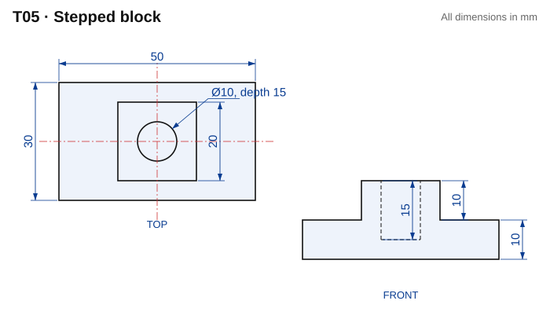

**Check:** volume = **17 822 mm³**

??? note "3D view"
    
    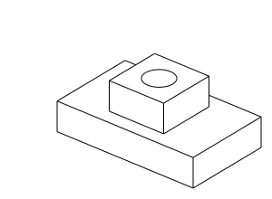

### T06 · Tee bar {#t06}

*sketch on Front, extrude*

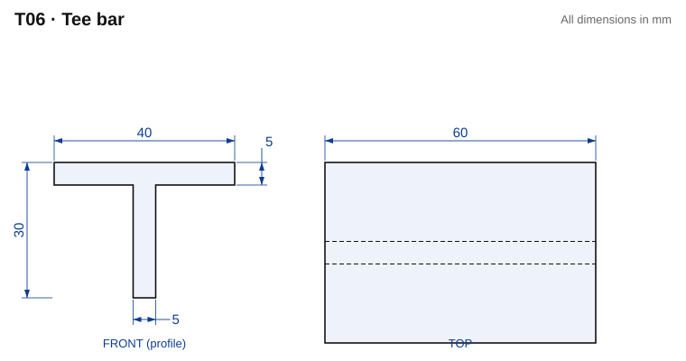

**Check:** volume = **19 500 mm³**

??? note "3D view"
    
    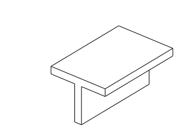

## Level 2 · Fillet and chamfer

### T07 · Rounded block {#t07}

*fillet, chamfer*

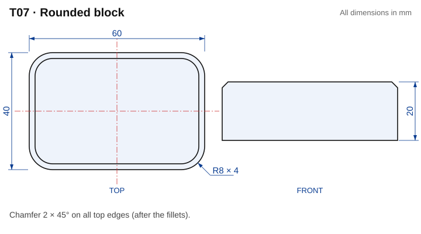

**Check:** volume = **46 537 mm³**

??? note "3D view"
    
    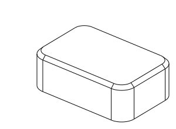

### T08 · D-shaft {#t08}

*extrude, chamfer, remove*

Order matters: make the round shaft, chamfer both ends, then cut the flat (1 deep).

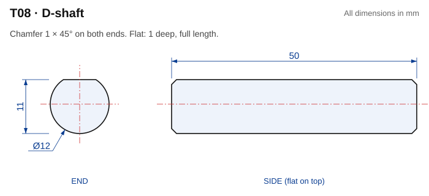

**Check:** volume = **5 400 mm³**

??? note "3D view"
    
    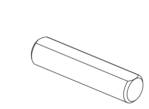

### T09 · Rounded L-bracket {#t09}

*sketch, extrude, fillet, holes*

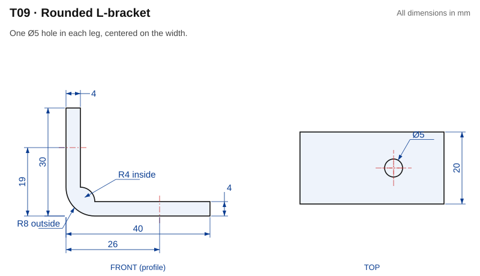

**Check:** volume = **4 917 mm³**

??? note "3D view"
    
    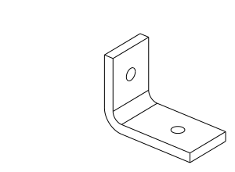

### T10 · Knob {#t10}

*extrude, fillet, chamfer, blind hole*

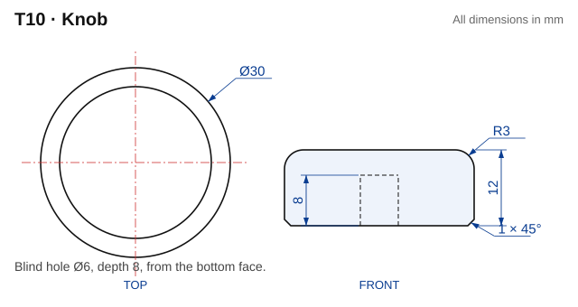

**Check:** volume = **8 036 mm³**

??? note "3D view"
    
    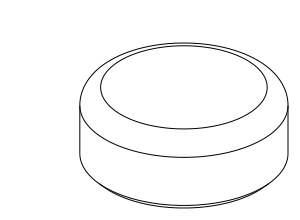

## Level 3 · Patterns

### T11 · Bolt-circle flange {#t11}

*circular pattern, construction circle*

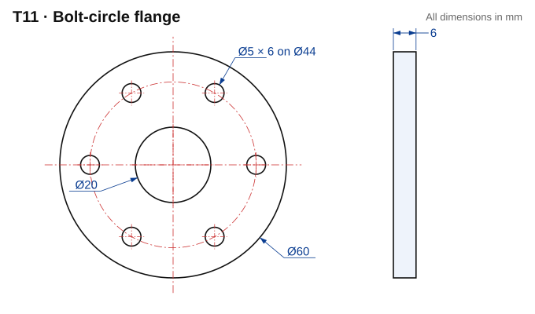

**Check:** volume = **14 373 mm³**

??? note "3D view"
    
    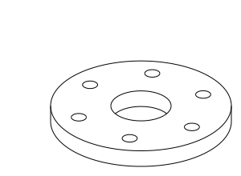

### T12 · Grid plate {#t12}

*linear pattern (2 directions), fillet*

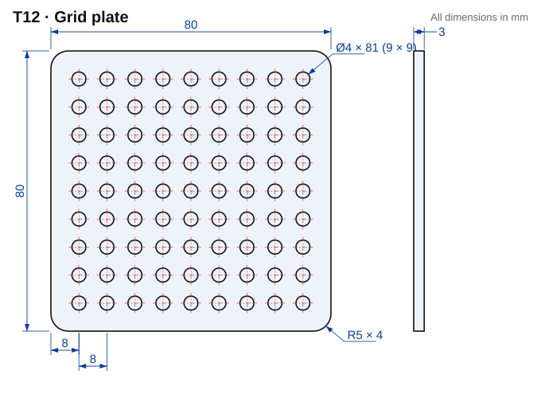

**Check:** volume = **16 082 mm³**

??? note "3D view"
    
    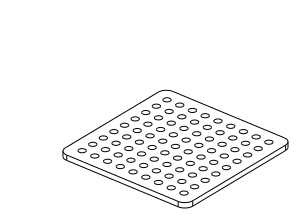

### T13 · Lightening plate {#t13}

*sketch pattern, fillet, remove*

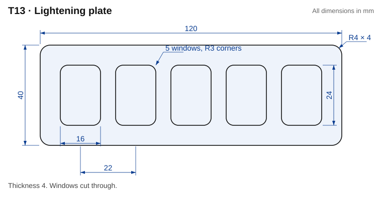

**Check:** volume = **11 620 mm³**

??? note "3D view"
    
    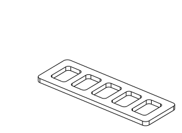

### T14 · Notched disk {#t14}

*circular pattern, remove*

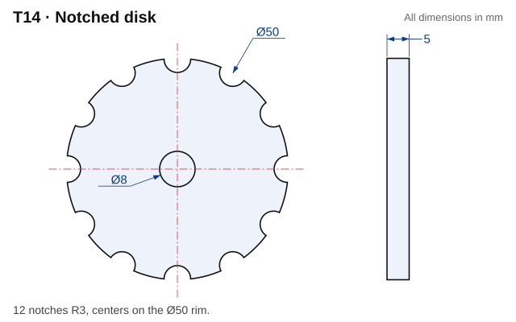

**Check:** volume = **8 740 mm³**

??? note "3D view"
    
    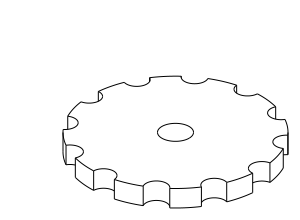

### T15 · Heat sink {#t15}

*extrude Add, feature pattern*

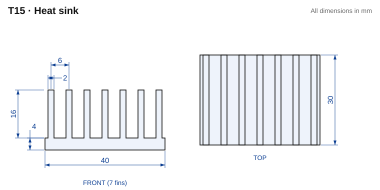

**Check:** volume = **11 520 mm³**

??? note "3D view"
    
    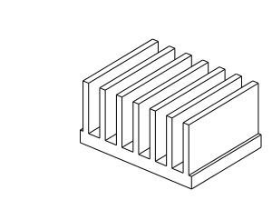

## Level 4 · Mirror and Boolean

### T16 · Pillow block {#t16}

*mirror, extrude Add, sketch on side face*

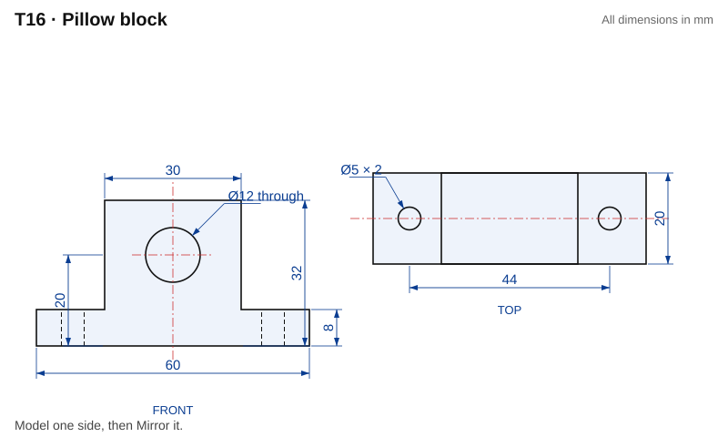

**Check:** volume = **21 424 mm³**

??? note "3D view"
    
    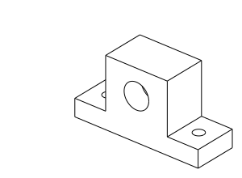

### T17 · Fork {#t17}

*mirror, extrude Add, hole across*

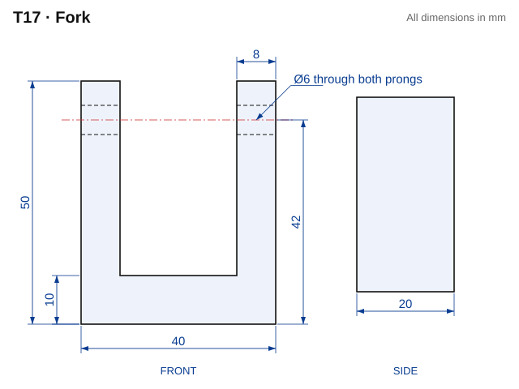

**Check:** volume = **20 348 mm³**

??? note "3D view"
    
    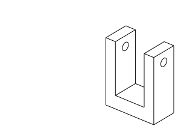

### T18 · Split clamp {#t18}

*remove, sketch on side face, slot*

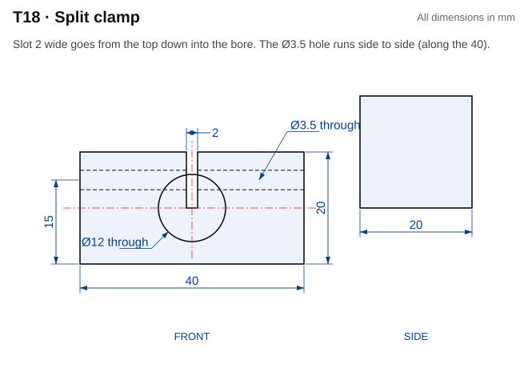

**Check:** volume = **13 251 mm³**

??? note "3D view"
    
    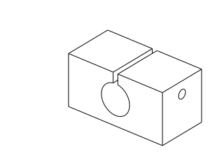

### T19 · Boolean: intersect {#t19}

*Boolean intersect, two parts*

Make two cylinders Ø40 × 40 as **separate parts** (New), one along Z and one along X, both centered on the origin. Then **Boolean → Intersect**. The result is one curved part.

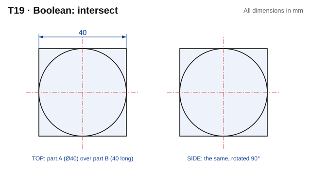

**Check:** volume = **42 667 mm³**

??? note "3D view"
    
    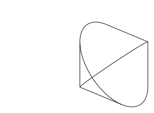

## Level 5 · Combined

### T20 · goBILDA-style bracket {#t20}

*sheet-like L, fillet, linear pattern, mirror*

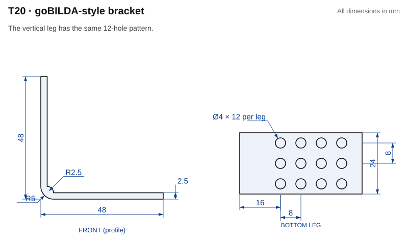

**Check:** volume = **4 759 mm³**

??? note "3D view"
    
    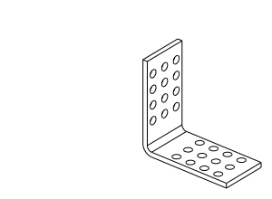

### T21 · Spoked wheel, N spokes {#t21}

*variables, feature pattern, extrude Add*

Make **N** a Variable. Your model must rebuild without errors for any N. Submit with N = 5 and check the volume for N = 7 too.

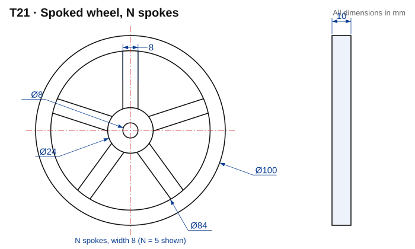

**Check:** volume = **39 118 mm³** for N = 5  **43 908 mm³** for N = 7

??? note "3D view"
    
    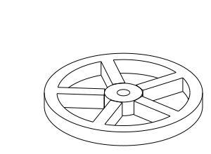

### T22 · Hex-bore pulley {#t22}

*stacked extrudes, polygon, circular pattern, chamfer*

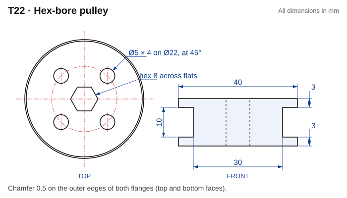

**Check:** volume = **12 434 mm³**

??? note "3D view"
    
    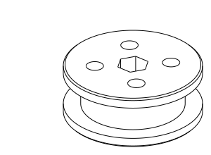

### T23 · Servo mount plate {#t23}

*sketch, chamfer, pattern, mirror*

The cutout fits a standard servo (40.5 × 20.2). Tab holes are 48 apart along the servo and 10 across.

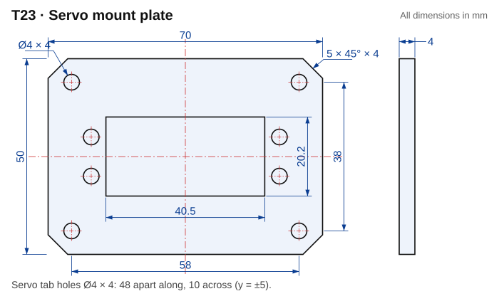

**Check:** volume = **10 125 mm³**

??? note "3D view"
    
    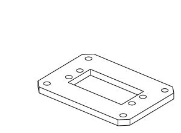

### T24 · Shooter side plate {#t24}

*everything: fillet, patterns, mirror, remove*

Origin = bottom-left corner. A combined task: plan the order of features before you start.

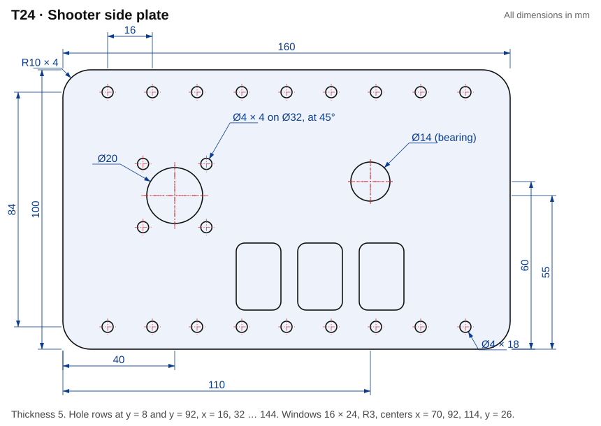

**Check:** volume = **70 204 mm³**

??? note "3D view"
    
    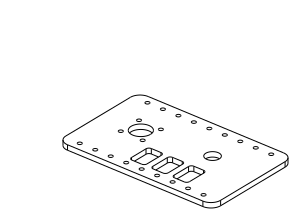
