# Practice

Parts from drawings. Most of them are **one sketch, one Extrude**: the work is in the sketch.

- One Onshape document per part: `Lastname - T26 - Rocker arm`.
- Check your answer: assign **Aluminum - 6061**, open **Mass properties**, compare the **volume**. Within ±1% counts as correct.
- Try to guess how you would build the part *before* opening the 3D view.

| # | Part | Topics | Volume, mm³ |
|---|---|---|---|
| [T25](#t25) | Grid plate with center window | linear pattern, skip instances, fillet, remove | 20 381 |
| [T26](#t26) | Rocker arm (one sketch) | one sketch, tangent, mirror in sketch, circular + linear pattern in sketch | 20 885 |
| [T27](#t27) | Tensioner plate | one sketch, arc slot, concentric, pattern | 12 994 |
| [T29](#t29) | Hex pocket plate | one sketch, polygon, two staggered linear patterns | 21 492 |
| [T30](#t30) | Encoder disk | one sketch, two circular patterns, construction circles | 4 306 |
| [T31](#t31) | Five-window wheel | one sketch, sketch fillet, circular pattern in sketch | 14 010 |
| [T32](#t32) | Truss rail | one sketch, two linear patterns, mirror in sketch | 16 311 |
| [T33](#t33) | Keyhole plate | one sketch, trim, 2-direction pattern in sketch | 14 840 |
| [T34](#t34) | Triangle gusset with holes | one sketch, pattern + delete instances, fillet in sketch | 11 628 |

## T25 · Grid plate with center window {#t25}

*linear pattern, skip instances, fillet, remove*

Same 8 mm grid as T12, but the 9 holes in the middle are replaced by a 20 × 20 window. Hint: pattern the holes, then use **Skip instances** in the pattern, or cut the window and delete the extra holes.

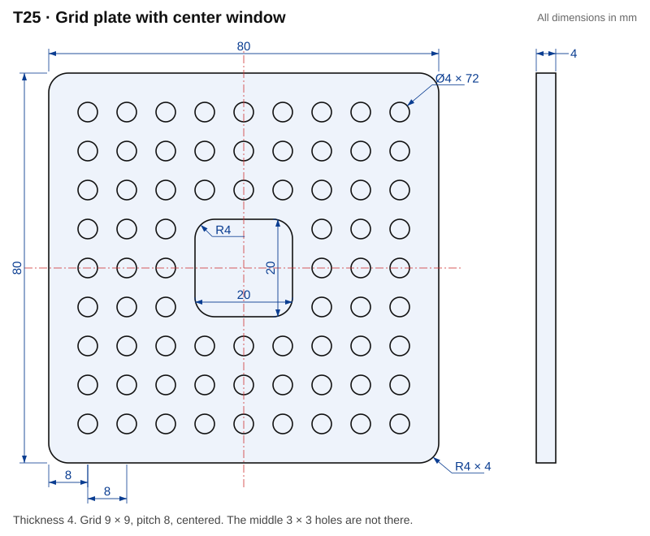

**Check:** volume = **20 381 mm³**

??? note "3D view"
    
    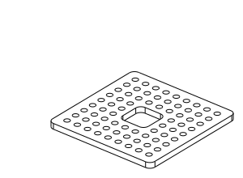

## T26 · Rocker arm (one sketch) {#t26}

*one sketch, tangent, mirror in sketch, circular + linear pattern in sketch*

Rule: **one sketch, one Extrude**. Everything (outline and all holes) must be in a single fully defined sketch. Draw the top tangent line once and use the sketch **Mirror** about a construction centerline; use the sketch **Circular pattern** and **Linear pattern** tools for the holes.

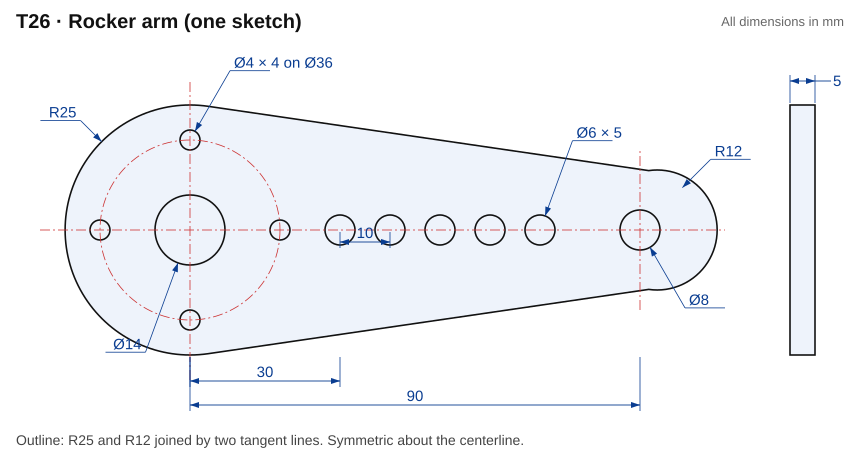

**Check:** volume = **20 885 mm³**

??? note "3D view"
    
    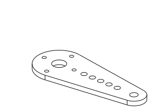

## T27 · Tensioner plate {#t27}

*one sketch, arc slot, concentric, pattern*

Rule: **one sketch, one Extrude**. Everything in a single fully defined sketch. The arc slot is centered on the pivot hole: a belt idler on it swings around the pivot.

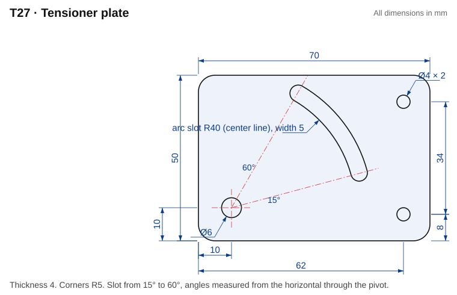

**Check:** volume = **12 994 mm³**

??? note "3D view"
    
    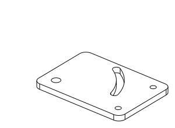

## T29 · Hex pocket plate {#t29}

*one sketch, polygon, two staggered linear patterns*

Rule: **one sketch, one Extrude**. Everything in a single fully defined sketch. Two patterns: one row of 7 and two rows of 6, shifted by half a step.

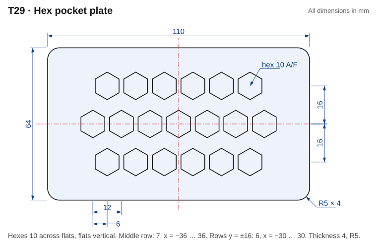

**Check:** volume = **21 492 mm³**

??? note "3D view"
    
    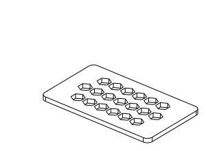

## T30 · Encoder disk {#t30}

*one sketch, two circular patterns, construction circles*

Rule: **one sketch, one Extrude**. Everything in a single fully defined sketch. Two circular patterns with different counts.

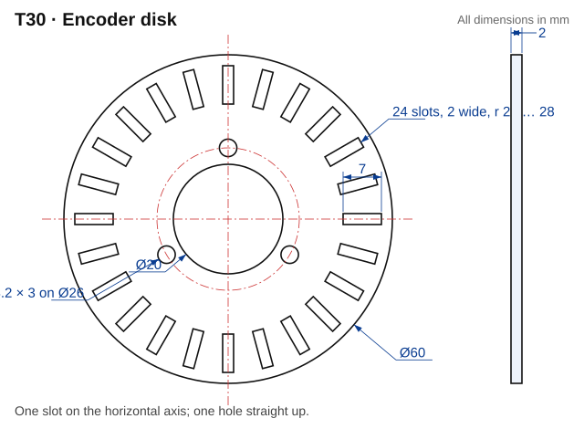

**Check:** volume = **4 306 mm³**

??? note "3D view"
    
    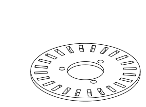

## T31 · Five-window wheel {#t31}

*one sketch, sketch fillet, circular pattern in sketch*

Rule: **one sketch, one Extrude**. Everything in a single fully defined sketch. Draw one window with its four R3 corners as sketch fillets, then pattern it.

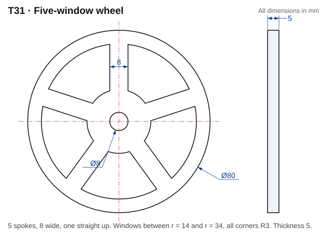

**Check:** volume = **14 010 mm³**

??? note "3D view"
    
    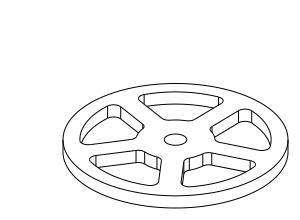

## T32 · Truss rail {#t32}

*one sketch, two linear patterns, mirror in sketch*

Rule: **one sketch, one Extrude**. Everything in a single fully defined sketch. Triangles pointing up and down: two linear patterns, shifted by half a step.

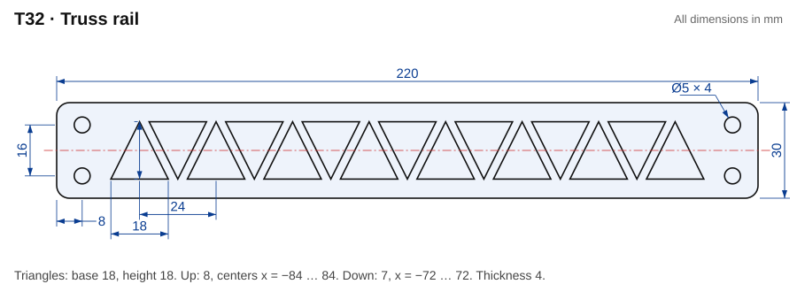

**Check:** volume = **16 311 mm³**

??? note "3D view"
    
    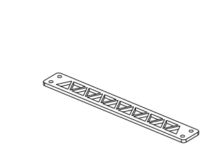

## T33 · Keyhole plate {#t33}

*one sketch, trim, 2-direction pattern in sketch*

Rule: **one sketch, one Extrude**. Everything in a single fully defined sketch. Each keyhole is a circle plus a slot: trim the lines inside so one closed outline is left.

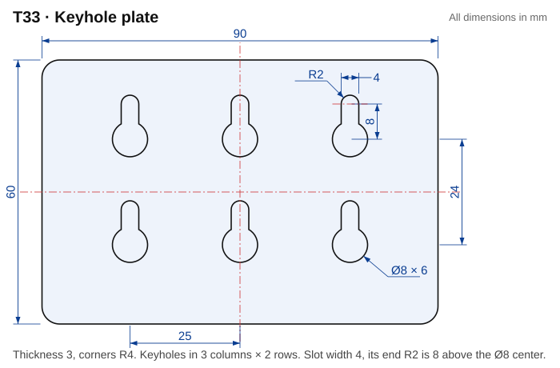

**Check:** volume = **14 840 mm³**

??? note "3D view"
    
    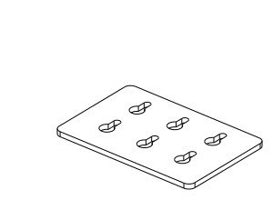

## T34 · Triangle gusset with holes {#t34}

*one sketch, pattern + delete instances, fillet in sketch*

Rule: **one sketch, one Extrude**. Everything in a single fully defined sketch. Pattern the holes in 2 directions, then remove the ones that fall outside the triangle.

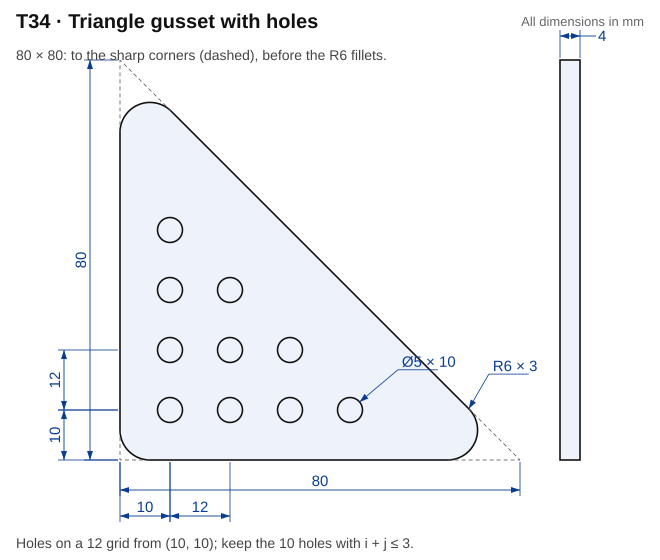

**Check:** volume = **11 628 mm³**

??? note "3D view"
    
    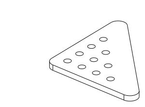
