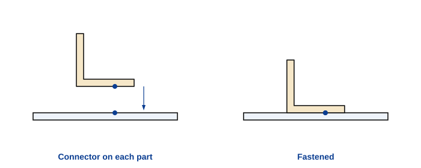

# Fastened

Joins two parts so they do not move relative to each other.

**Where:** Assembly toolbar → **Fastened**.

## When to use

Anything screwed together: brackets to plates, the control hub to the chassis.

## Main options

| Option | What it does |
|---|---|
| Mate connectors | One on each part, usually hole centers |
| Flip primary axis | Turns one part over |
| Offset | Gap between the connectors |

## Picture

## Common mistakes

- **Bracket inside the plate.** Flip the primary axis.
- **Wrong hole.** Pick the hole edge on both parts.
- **Fastened where it should turn.** A wheel on an axle is Revolute.

## Used in

- [Lesson 4 · Assembly](../../lesson-4.md#4-assembly)
- [Lesson 4 · Practice 4-1, 4-2, 4-4](../../lesson-4.md#6-practice)
- [Team robot](../../robot/index.md)

[Fastened mate](https://cad.onshape.com/help/Content/mate-fastened.htm){target=_blank}
