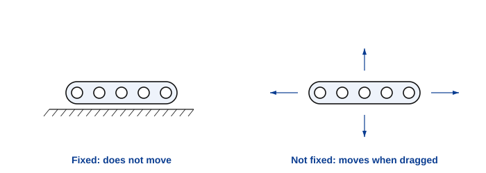

# Fix

Locks a part in place in the assembly.

**Where:** Right-click a part → **Fix**.

## When to use

The base of each subassembly: the chassis plate, the turret base.

## Main options

| Option | What it does |
|---|---|
| **Fix** | The part cannot move |
| **Unfix** | Frees it again |

## Picture

## Common mistakes

- **Nothing fixed.** The whole assembly flies away when you drag it.
- **Everything fixed.** Mates are ignored; fix only the first part.

## Used in

- [Lesson 4 · Assembly](../../lesson-4.md#4-assembly)

[Onshape help](https://cad.onshape.com/help/){target=_blank}
