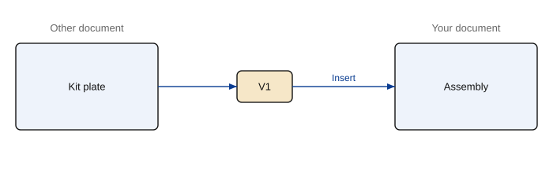

# Insert

Adds parts or assemblies to an assembly.

**Where:** Assembly toolbar → **Insert**.

## When to use

Every robot subassembly: your Part Studios, the kit plates, the motor from another document.

## Main options

| Tab | What it inserts |
|---|---|
| **Current document** | Part Studios and assemblies of this document |
| **Other documents** | From a **Version** of another document |
| Configuration | Choose it while inserting |
| Insert several times | Several copies of one part |

## Picture

## Common mistakes

- **Part from another document not found.** The author has not made a Version yet.
- **Whole Part Studio inserted** when you wanted one part: expand it and pick the part.

## Used in

- [Lesson 4 · Assembly](../../lesson-4.md#4-assembly)
- [Lesson 4 · Practice](../../lesson-4.md#6-practice)

[Onshape help](https://cad.onshape.com/help/){target=_blank}
