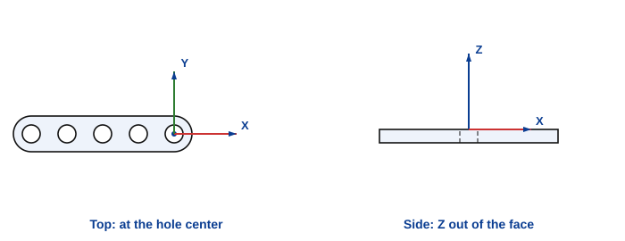

# Mate connector

A point with X, Y, Z axes on a part, used by mates.

**Where:** Appears when you pick geometry in a mate; also a separate **Mate connector** tool.

## When to use

Every mate: hole center to hole center when a bracket is screwed to a plate.

## Main options

| Pick | Connector goes to |
|---|---|
| Circular edge | The center of the hole, Z along the hole axis |
| Flat face | The face center, Z out of the face |
| Vertex | The point |
| Offset, rotation | Move or turn the connector |

## Picture

## Common mistakes

- **Picked a face instead of the hole edge.** The parts line up at the wrong place.
- **Z points the wrong way.** Flip it in the mate.

## Used in

- [Lesson 4 · Assembly](../../lesson-4.md#4-assembly)

[Mate connector](https://cad.onshape.com/help/Content/mateconnector.htm){target=_blank}
