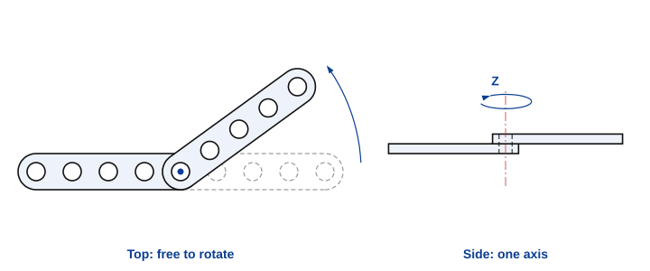

# Revolute

Connects two parts so that one can only rotate around one common axis.

**Where:** Assembly toolbar → **Revolute**.

## When to use

Anything that turns on a shaft or a screw: a four-bar linkage, a wheel on its axle, the turret, the hood hinge.

## Main options

| Option | What it does |
|---|---|
| **Mate connectors** | One on each part, at the hole center. Their **Z** axes become the rotation axis |
| **Flip primary axis** | Turns one part over if it faces the wrong way |
| **Offset** | Gap along the axis, e.g. for a washer |
| **Limits** | Minimum and maximum angle |

## Picture

## Common mistakes

- **Connector on a face, not on the hole center.** The part spins around the wrong point. Pick the circular edge of the hole.
- **The whole assembly moves when you drag.** Nothing is fixed: **Fix** the first part.
- **Parts overlap on the axis.** Use **Offset** or pick the connector on the other face.
- **Revolute where it should be fixed.** If the part must not turn (a bracket on a plate), use **Fastened**.

## Used in

- [Lesson 4 · Assembly](../../lesson-4.md#4-assembly)
- [Lesson 4 · Practice 4-3](../../lesson-4.md#6-practice): four-bar linkage
- [Team robot](../../robot/index.md): drive wheels, intake roller, turret, hood

[Onshape help: Revolute mate](https://cad.onshape.com/help/Content/mate-revolute.htm){target=_blank}
