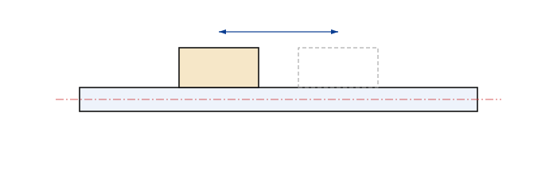

# Slider

Lets a part move only along one axis.

**Where:** Assembly toolbar → **Slider**.

## When to use

A carriage on a rail, a linear slide.

## Main options

| Option | What it does |
|---|---|
| Mate connectors | Their Z axis is the direction of motion |
| Flip primary axis | Turns one part over |
| Limits | Minimum and maximum travel |

## Picture

## Common mistakes

- **Moves the wrong way.** The connector Z axis must point along the slide.
- **Runs off the rail.** Add limits.

## Used in

- [Lesson 4 · Assembly](../../lesson-4.md#4-assembly)
- [L3-8](../../lesson-3.md#l38)

[Slider mate](https://cad.onshape.com/help/Content/mate-slider.htm){target=_blank}
