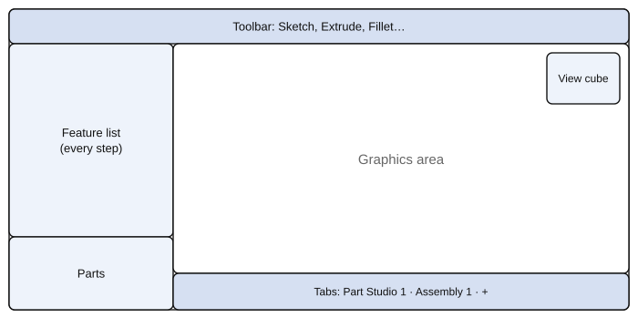

# Interface

The parts of the Onshape window and what each one is for.

**Where:** Open any document.

## When to use

Every lesson. Know where the Feature list and the Parts list are before you start the robot document.

## Main options

| Area | What it is |
|---|---|
| **Toolbar** | All features of the current tab: Sketch, Extrude, Fillet… |
| **Feature list** | Every step of the model, in order. Double-click to edit, drag the rollback bar to go back |
| **Parts** | All parts of this Part Studio. Double-click to rename |
| **Graphics area** | The model |
| **View cube** | Click a side to look straight at it |
| **Tabs** | Part Studios, Assemblies and Drawings of the document |

## Picture

## Common mistakes

- **Editing the wrong step.** Check which feature is highlighted in the Feature list.
- **Rollback bar left in the middle.** Features below it are not built. Drag it back to the end.
- **Too many Part Studios.** One part per Part Studio is the robot rule; helper sketches stay in the same Part Studio.

## Used in

- [Lesson 1 · Create a document and set units](../../lesson-1.md#1-create-a-document-and-set-units)

[Onshape help](https://cad.onshape.com/help/){target=_blank}
