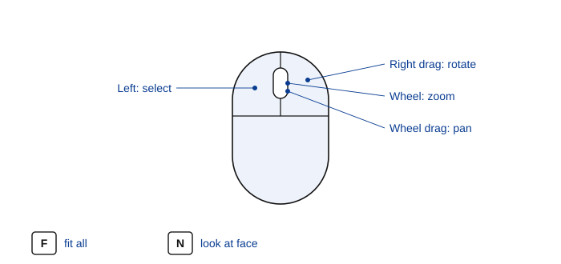

# Navigation and shortcuts

How to rotate, pan and zoom, and the keys used most.

**Where:** Mouse and keyboard in the graphics area.

## When to use

All the time. Look straight at a face (++n++) before you sketch on it.

## Main options

| Action | How |
|---|---|
| Rotate | right mouse button drag |
| Pan | middle button drag, or ++ctrl++ + right button drag |
| Zoom | scroll |
| Fit everything | ++f++ |
| Look at a face | select it, ++n++ |
| Sketch | ++shift+s++ |
| Extrude | ++shift+e++ |
| Fillet | ++shift+f++ |
| Dimension | ++d++ |

## Picture

## Common mistakes

- **Model lost off screen.** Press ++f++.
- **Sketching at an angle.** Press ++n++ first, it is much easier to place points.
- **Keys do nothing.** The cursor must be over the graphics area.

## Used in

- [Lesson 1 · Move around](../../lesson-1.md#2-move-around)

[Keyboard shortcuts](https://cad.onshape.com/help/Content/shortcut_keys.htm){target=_blank}
