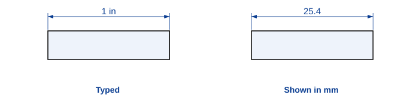

# Units

Sets which unit a number means when you type it without one.

**Where:** Document menu (☰) → **Workspace units**.

## When to use

Once per document, before the first sketch: Length **Millimeter**, Mass **Gram**. All robot drawings are in mm.

## Main options

| Setting | Use |
|---|---|
| Length | Millimeter |
| Angle | Degree |
| Mass | Gram |
| Typed unit | `1 in`, `5 cm` work in any field and are converted |

## Picture

## Common mistakes

- **Plate 96 inches long.** Units were left at inch. Set mm before you start.
- **Mixing units on purpose.** Only type a unit when the size really is given in it (a 1/2 in hex shaft).

## Used in

- [Lesson 1 · Create a document and set units](../../lesson-1.md#1-create-a-document-and-set-units)

[Onshape help](https://cad.onshape.com/help/){target=_blank}
