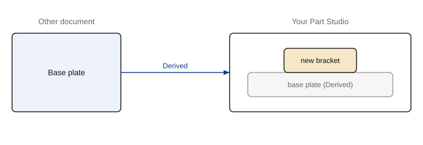

# Derived

Brings a part from another document into your Part Studio, to model around it.

**Where:** Part Studio toolbar → **Derived**.

## When to use

A bracket that fits the holes of the base plate from another document.

## Main options

| Option | What it does |
|---|---|
| Source | A Version of another document |
| Parts | Which parts to bring |
| Configuration | Pick the size |
| Update | Follow a newer version |

## Picture

## Common mistakes

- **Derived instead of Insert.** To put parts together use an Assembly; Derived is only for modeling around.
- **Derived part left in the final model.** Hide it or delete it at the end.

## Used in

- [Lesson 4 · Derived and STEP](../../lesson-4.md#5-derived-and-step)

[Derived](https://cad.onshape.com/help/Content/derived.htm){target=_blank}
