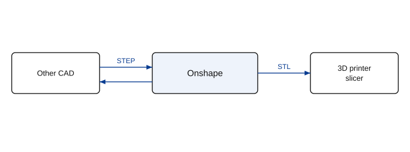

# Import and Export

Moves models between Onshape and other programs.

**Where:** Right-click a part or a tab → **Export**; **Import** on the document page.

## When to use

STEP from goBILDA or REV to use real parts; STL to 3D-print a part.

## Main options

| Format | Use |
|---|---|
| **STEP** | Exchange with other CAD and manufacturers. Imported STEP has no feature tree |
| **STL** | 3D printing |
| Units | Check mm on export |

## Picture

## Common mistakes

- **Editing an imported STEP like your own part.** It has no features; model around it.
- **STL in inches.** Choose mm.

## Used in

- [Lesson 4 · Derived and STEP](../../lesson-4.md#5-derived-and-step)

[Exporting files](https://cad.onshape.com/help/Content/exporting-files.htm){target=_blank}
