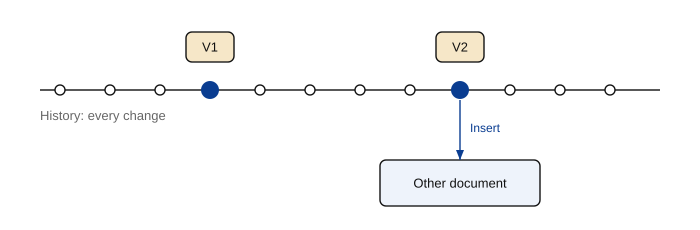

# Versions and History

A Version is a named snapshot of the document; History is every change.

**Where:** Document toolbar → **Versions and history** (clock icon).

## When to use

Make a Version of your robot document before the master assembly uses it, the way you commit in git.

## Main options

| Item | What it does |
|---|---|
| **Version** | Saved snapshot, like a commit |
| **History** | All changes; open or restore an older state |
| Insert from a version | Other documents insert your parts from a Version |
| **Update** | When a new Version exists, the user can update |

## Picture

## Common mistakes

- **No Version.** Nobody can insert your parts.
- **Changes not visible in the master.** Make a new Version; the master must click Update.

## Used in

- [Lesson 4 · Versions](../../lesson-4.md#2-versions-git-inside-onshape)

[Onshape help](https://cad.onshape.com/help/){target=_blank}
