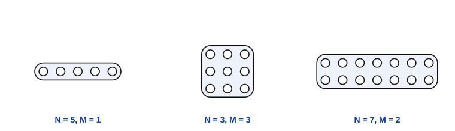

# Configurations

Turns variable values into a list to choose from: one part, many sizes.

**Where:** Part Studio → **Configuration** panel.

## When to use

The kit plate: pick N × M holes when you insert it.

## Main options

| Item | What it does |
|---|---|
| Input | A list or a number |
| Values per row | Each row sets the variables |
| Choose when inserting | In the Insert dialog |
| Change later | Right-click the part in the assembly |

## Picture

## Common mistakes

- **Configured value not used.** The feature still has a typed number instead of `#N`.
- **Wrong size in the assembly.** Change the configuration of the inserted part.

## Used in

- [Lesson 4 · Variables and configurations](../../lesson-4.md#1-variables-and-configurations-overview)

[Configurations](https://cad.onshape.com/help/Content/configurations.htm){target=_blank}
