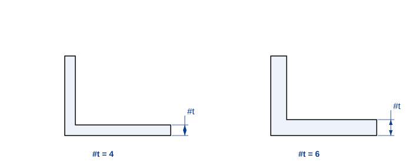

# Variables

A named number, used in dimensions and features.

**Where:** Part Studio toolbar → **Variable** (`#name`).

## When to use

The plate thickness `#t` used in every cut, the hole counts `#N`, `#M` of the kit plate.

## Main options

| Item | Example |
|---|---|
| Name | `t` |
| Value | `4 mm` |
| Use it | type `#t` in any dimension or depth |
| Expression | `#t * 2`, `#N * 8` |

## Picture

## Common mistakes

- **Variable defined after it is used.** It must be above the feature in the Feature list.
- **Depth typed as a number** next to a variable thickness: it does not follow.

## Used in

- [Lesson 3 · L3-4](../../lesson-3.md#l34)
- [Lesson 4 · Variables and configurations](../../lesson-4.md#1-variables-and-configurations-overview)
- [T39](../../practice.md#t39)

[Variable](https://cad.onshape.com/help/Content/variable.htm){target=_blank}
