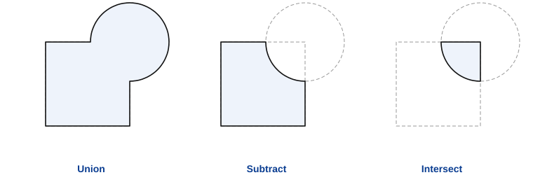

# Boolean

Combines parts that already exist: union, subtract, intersect.

**Where:** Part Studio toolbar → **Boolean**.

## When to use

A bore that always fits the shaft: subtract the shaft from the block and keep the shaft.

## Main options

| Option | Result |
|---|---|
| **Union** | Several parts become one |
| **Subtract** | Tools are cut out of targets |
| **Keep tools** | The tool part stays |
| **Intersect** | Only the common volume is kept |

## Picture

## Common mistakes

- **Shaft disappeared.** Tick Keep tools.
- **Targets and tools swapped.** The target is the part that gets the hole.

## Used in

- [Lesson 3 · Boolean](../../lesson-3.md#boolean)
- [L3-1](../../lesson-3.md#l31)
- [L3-2](../../lesson-3.md#l32)
- [T36](../../practice.md#t36)
- [T37](../../practice.md#t37)

[Boolean](https://cad.onshape.com/help/Content/booleanparts.htm){target=_blank}
