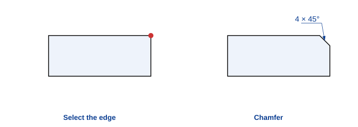

# Chamfer

Cuts an edge at an angle.

**Where:** Part Studio toolbar → **Chamfer**.

## When to use

Ends of shafts and hubs so parts slide on, edges of holes.

## Main options

| Option | What it does |
|---|---|
| Edges or faces | What to cut |
| Distance | Equal distance: 45° |
| Two distances / Distance and angle | Non-45° chamfer |
| Tangent propagation | Follows smooth edges |

## Picture

## Common mistakes

- **Wrong side** with two distances: flip it.
- **Chamfer on a sketch corner** is a sketch chamfer, not this feature.

## Used in

- [Lesson 3 · 3D operations](../../lesson-3.md#4-3d-operations-on-parts)
- [L3-1](../../lesson-3.md#l31)
- [L3-7](../../lesson-3.md#l37)

[Chamfer](https://cad.onshape.com/help/Content/chamfer.htm){target=_blank}
