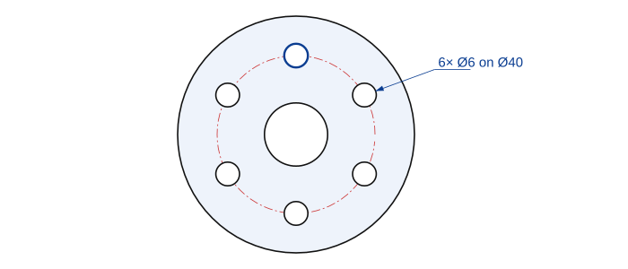

# Circular pattern

Repeats features, parts or faces around an axis.

**Where:** Part Studio toolbar → **Circular pattern**.

## When to use

Holes on a bolt circle of a hub or a turret plate.

## Main options

| Option | What it does |
|---|---|
| Pattern type | Feature / Part / Face |
| Axis | A cylindrical face, edge or axis |
| Angle and count | 360° and N, the original included |
| Equal spacing | Spreads the copies over the angle |

## Picture

## Common mistakes

- **Wrong axis.** Pick the bore face of the hub, not an edge on the rim.
- **360° without Equal spacing.** Copies pile up; tick it.

## Used in

- [Lesson 3 · 3D operations](../../lesson-3.md#4-3d-operations-on-parts)
- [L3-7](../../lesson-3.md#l37)

[Circular pattern](https://cad.onshape.com/help/Content/circularpattern.htm){target=_blank}
