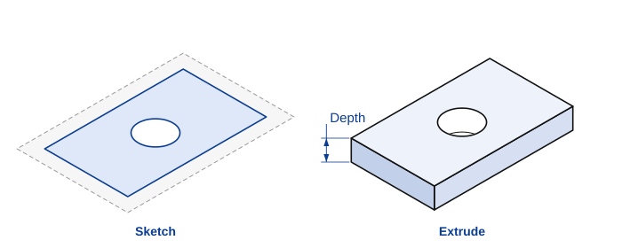
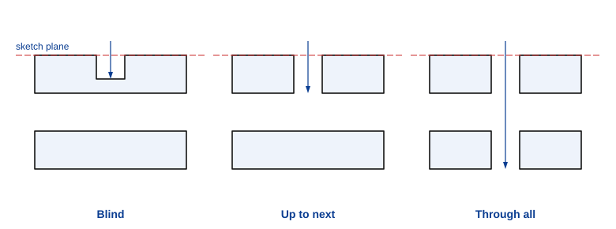

# Extrude

Turns a closed sketch region into a solid by pushing it along the normal of the sketch plane.

**Where:** Part Studio toolbar → **Extrude** (++shift+e++).

## When to use

Almost every flat robot part: a 3 mm base plate, a side plate, a spacer. Also every hole or pocket that goes straight through: Extrude with **Remove**.

## Main options

| Option | What it does |
|---|---|
| **New / Add / Remove / Intersect** | New part, merge into parts, cut from parts, keep only the overlap |
| **Merge scope** | Which parts Add / Remove / Intersect affect |
| **End type** | Blind, Symmetric, Up to next, Up to face / part / vertex, Through all |
| **Second direction** | Extrude to the other side too, by a different amount |
| **Thin** | Extrude only the sketch lines with a wall thickness: channels, angles |

## Picture

## Common mistakes

- **Typed depth for a through cut.** If the part gets thicker later, the hole stops halfway. Use **Through all** or **Up to next**.
- **"Why do I have two parts?"** The extrude was **New**, or it does not touch the old part. Use **Add**.
- **Remove cuts the wrong part.** Check **Merge scope**.
- **Wrong region.** One sketch has several regions; select exactly the ones you need.

## Used in

- [Lesson 1 · Extrude](../../lesson-1.md#4-extrude)
- [Lesson 3 · Extrude in depth](../../lesson-3.md#1-extrude-in-depth)
- [L3-2](../../lesson-3.md#l32) · [L3-3](../../lesson-3.md#l33) · [L3-5](../../lesson-3.md#l35) · [L3-7](../../lesson-3.md#l37) · [L3-8](../../lesson-3.md#l38)
- [T25](../../practice.md#t25) and almost every other task

[Onshape help: Extrude](https://cad.onshape.com/help/Content/extrude.htm){target=_blank}
