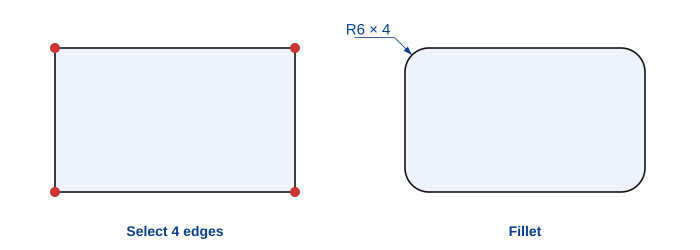

# Fillet

Rounds edges of a part.

**Where:** Part Studio toolbar → **Fillet** (++shift+f++).

## When to use

Plate corners (R4 on the kit plates), inner bends of brackets.

## Main options

| Option | What it does |
|---|---|
| Edges or faces | What to round |
| Radius | Size of the round |
| **Tangent propagation** | Follows a chain of smooth edges |

## Picture

## Common mistakes

- **Fillet fails.** The radius is bigger than the face next to it.
- **Fillet breaks after a change.** Edges it used are gone. Fillet late in the Feature list, or use a sketch fillet.
- **One fillet per edge.** Select all edges with the same radius in one feature.

## Used in

- [Lesson 1 · Round the corners](../../lesson-1.md#7-round-the-corners)
- [Lesson 3 · 3D operations](../../lesson-3.md#4-3d-operations-on-parts)
- [L3-4](../../lesson-3.md#l34)
- [T25](../../practice.md#t25)

[Fillet](https://cad.onshape.com/help/Content/fillet.htm){target=_blank}
