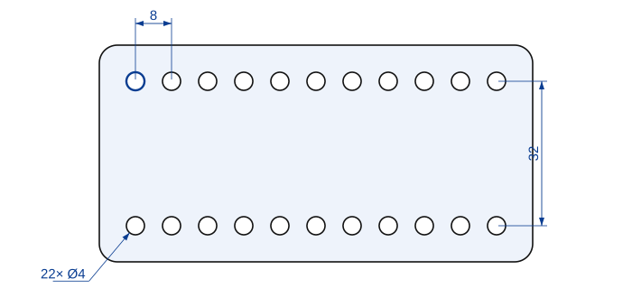

# Linear pattern

Repeats features, parts or faces in a straight line, one or two directions.

**Where:** Part Studio toolbar → **Linear pattern**.

## When to use

Hole grids: the 8 mm goBILDA-style grid of the base plate.

## Main options

| Option | What it does |
|---|---|
| **Feature pattern** | Repeats features; change the first, all change |
| **Part pattern** / **Face pattern** | Copies whole parts / faces |
| Direction, distance, count | Spacing and number, the original included |
| Second direction | A grid |
| Skip instances | Leaves some copies out |

## Picture

## Common mistakes

- **Pattern runs off the part.** Flip the direction arrow.
- **Distance is the total length.** It is the spacing.
- **Part pattern instead of feature pattern.** You get new parts instead of holes.

## Used in

- [Lesson 1 · Pattern](../../lesson-1.md#6-one-small-hole-then-a-pattern)
- [Lesson 3 · 3D operations](../../lesson-3.md#4-3d-operations-on-parts)
- [T25](../../practice.md#t25)

[Linear pattern](https://cad.onshape.com/help/Content/linearpattern.htm){target=_blank}
