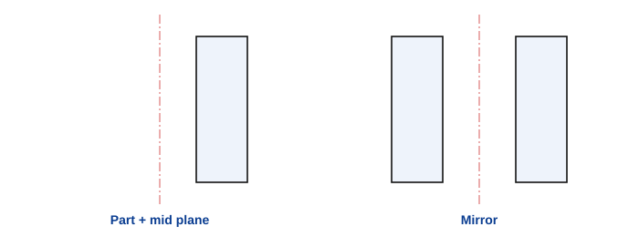

# Mirror

Copies features, parts or faces across a plane.

**Where:** Part Studio toolbar → **Mirror**.

## When to use

Left and right side plates, two bearing blocks on one shaft, two gussets on a bracket.

## Main options

| Option | What it does |
|---|---|
| **Part mirror** | A new mirrored part |
| **Feature mirror** | Mirrored features on the same part |
| **Face mirror** | Mirrored faces |
| Mirror plane | A plane or flat face |

## Picture

## Common mistakes

- **No plane in the middle.** Make one with **Plane → Mid plane**.
- **Part mirror for a hole.** Use Feature mirror.

## Used in

- [Lesson 3 · 3D operations](../../lesson-3.md#4-3d-operations-on-parts)
- [L3-1](../../lesson-3.md#l31)
- [L3-4](../../lesson-3.md#l34)

[Mirror](https://cad.onshape.com/help/Content/mirror.htm){target=_blank}
