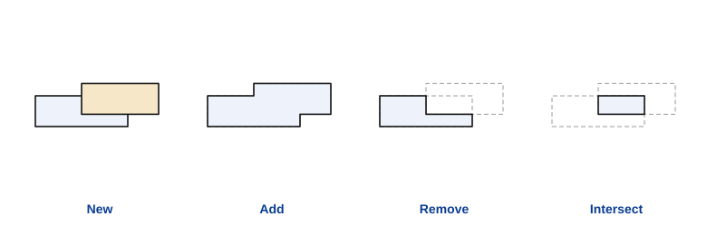

# New / Add / Remove / Intersect

Decides what an Extrude, Revolve or other feature does to existing parts.

**Where:** Top of the Extrude (Revolve, Sweep…) dialog.

## When to use

New for a separate robot part, Add for a boss on a plate, Remove for holes and pockets.

## Main options

| Option | Result |
|---|---|
| **New** | A new separate part |
| **Add** | Merged into parts in Merge scope |
| **Remove** | Cut from parts in Merge scope |
| **Intersect** | Only the overlap is kept |
| **Merge scope** | Which parts are affected |

## Picture

## Common mistakes

- **"Why do I have two parts?"** It was New, or the new shape does not touch the old one.
- **Cut went into the wrong part.** Check Merge scope.

## Used in

- [Lesson 3 · New / Add / Remove / Intersect](../../lesson-3.md#new-add-remove-intersect)
- [L3-3](../../lesson-3.md#l33)
- [T38](../../practice.md#t38)

[Extrude](https://cad.onshape.com/help/Content/extrude.htm){target=_blank}
