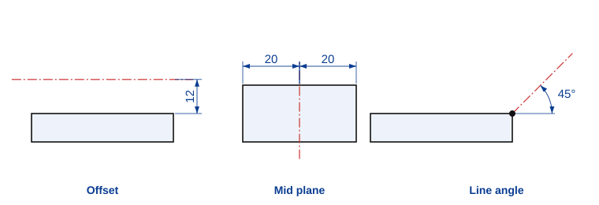

# Plane

Makes a new sketch plane where there is no face.

**Where:** Part Studio toolbar → **Plane**.

## When to use

Sketching in the middle of a part, cutting from inside, splitting at a height.

## Main options

| Type | What you select |
|---|---|
| **Offset** | A plane or face, and a distance |
| **Mid plane** | Two parallel faces |
| **Line angle** | An edge and an angle |
| Others | Point normal, three points, … |

## Picture

## Common mistakes

- **Sketching on a face that will change.** If the face moves, the sketch moves too. Sometimes that is right, sometimes a plane is better.
- **Offset in the wrong direction.** Flip it.

## Used in

- [Lesson 3 · Where to sketch](../../lesson-3.md#3-where-to-sketch)
- [L3-1](../../lesson-3.md#l31)
- [L3-3](../../lesson-3.md#l33)
- [T38](../../practice.md#t38)

[Plane](https://cad.onshape.com/help/Content/cplane.htm){target=_blank}
