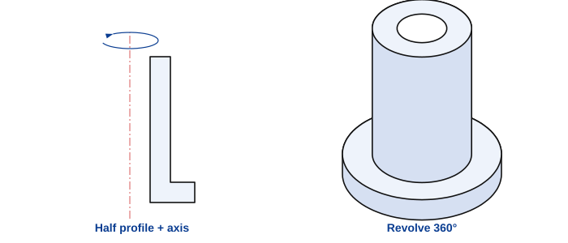

# Revolve

Turns a sketch region around an axis into a round solid.

**Where:** Part Studio toolbar → **Revolve**.

## When to use

Round parts: spacers, hubs, wheels, the flywheel, shafts with steps.

## Main options

| Option | What it does |
|---|---|
| Region | Half profile, on one side of the axis |
| Axis | A line or edge |
| **Full** / **One direction** / **Symmetric** / **Two directions** | 360° or a set angle |
| New / Add / Remove / Intersect | As in Extrude |

## Picture

## Common mistakes

- **Profile crosses the axis.** The revolve fails; draw only one half.
- **Whole section drawn.** Revolve a half profile, not both halves.
- **Axis drawn as a solid line inside the region.** Make it Construction or pick an edge.

## Used in

- [Lesson 3 · 3D operations](../../lesson-3.md#4-3d-operations-on-parts)
- [L3-1](../../lesson-3.md#l31)
- [L3-7](../../lesson-3.md#l37)

[Revolve](https://cad.onshape.com/help/Content/revolve.htm){target=_blank}
