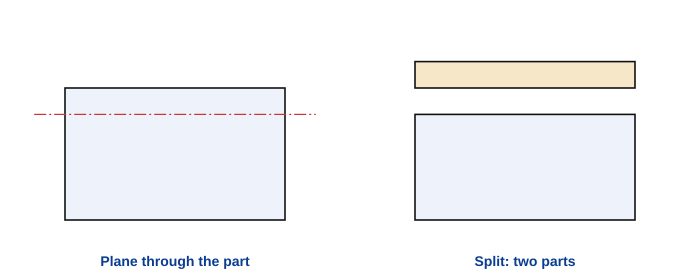

# Split

Cuts a part into two parts with a plane or a face.

**Where:** Part Studio toolbar → **Split**.

## When to use

A box into base and lid, the battery holder into a tray and a clamp.

## Main options

| Option | What it does |
|---|---|
| Parts to split | The part |
| Entity to split with | A plane, face or surface |
| Keep both sides | Both parts stay |

## Picture

## Common mistakes

- **No plane at the right height.** Make a Plane first.
- **Split by a face that ends inside the part.** Use a plane, it is infinite.

## Used in

- [Lesson 3 · Split](../../lesson-3.md#split)
- [L3-3](../../lesson-3.md#l33)
- [T38](../../practice.md#t38)

[Split](https://cad.onshape.com/help/Content/splitpart.htm){target=_blank}
