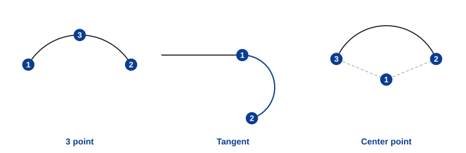

# Arc

Draws part of a circle.

**Where:** Sketch toolbar → **Arc**.

## When to use

Rounded ends of arms and links, curved slots for adjustable motor mounts.

## Main options

| Option | How to draw |
|---|---|
| **3 point** | Both ends, then a point on the arc |
| **Tangent** | Starts from the end of a line and continues it smoothly; the tangency is added for you |
| **Center point** | Center, start, end |

## Picture

## Common mistakes

- **Kink between line and arc.** Use Tangent arc, or add Tangent.
- **Arc flips to the other side.** Move the mouse to the side you want before the last click.

## Used in

- [Lesson 2 · One shape, several ways](../../lesson-2.md#1-one-shape-several-ways-to-draw-it)
- [Lesson 2 · Motor mount](../../lesson-2.md#4-a-model-for-the-lesson)
- [T27](../../practice.md#t27)

[Sketch tools](https://cad.onshape.com/help/Content/sketch-tools.htm){target=_blank}
