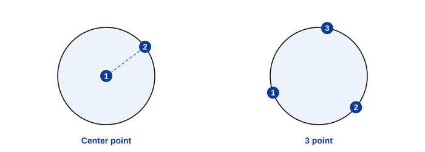

# Circle

Draws a circle: holes, round plates, bolt circles.

**Where:** Sketch toolbar → **Circle** (++c++).

## When to use

Every hole for a screw or a shaft: Ø4 on the 8 mm grid, Ø14 center hole. A construction circle is the pitch circle of a hole pattern.

## Main options

| Option | How to draw |
|---|---|
| **Center point** | Center, then a point on the circle |
| **3 point** | Three points on the circle |
| **Construction** | A helper circle for patterns and Concentric |

## Picture

## Common mistakes

- **Radius typed as diameter.** Onshape shows Ø by default; type the diameter from the drawing.
- **Hole not on the grid.** Dimension the center to an edge or to the origin, not the edge of the circle.
- **Pitch circle extruded.** Make it Construction.

## Used in

- [Lesson 1 · Center hole](../../lesson-1.md#5-center-hole)
- [Lesson 2 · One shape, several ways](../../lesson-2.md#1-one-shape-several-ways-to-draw-it)
- [T30](../../practice.md#t30)

[Sketch tools](https://cad.onshape.com/help/Content/sketch-tools.htm){target=_blank}
