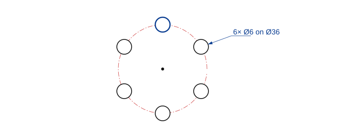

# Sketch circular pattern

Copies sketch geometry around a point, N times.

**Where:** Sketch toolbar → **Circular pattern**.

## When to use

Holes on a bolt circle, windows of a wheel.

## Main options

| Option | What it does |
|---|---|
| Entities | What to copy |
| Center | A point, usually the origin |
| Count | Number of copies, the original included |
| Angle | 360° for a full circle |

## Picture

## Common mistakes

- **Wrong center.** Pick the center point, not a point on the circle.
- **Seed not on the pitch circle.** Put the first hole on a construction circle with Coincident.

## Used in

- [Lesson 2 · Circular pattern: flange](../../lesson-2.md#circular-pattern-flange-with-notches)
- [T26](../../practice.md#t26)
- [T30](../../practice.md#t30)
- [T31](../../practice.md#t31)
- [T35](../../practice.md#t35)

[Sketch pattern](https://cad.onshape.com/help/Content/sketch-tools-sketch-pattern.htm){target=_blank}
