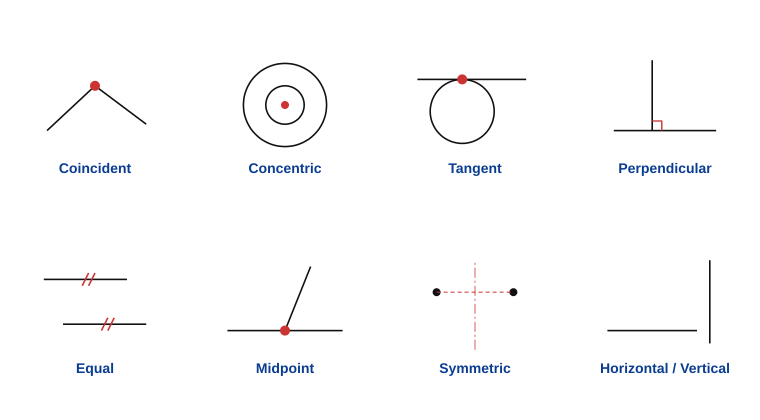

# Constraints

Rules between sketch elements that remove degrees of freedom.

**Where:** Sketch toolbar, constraint icons; most are also added while you draw.

## When to use

Every sketch. A fully defined (black) sketch never moves by accident when you change a number.

## Main options

| Constraint | What it does |
|---|---|
| **Coincident** | point on point, or point on a curve |
| **Concentric** | same center |
| **Tangent** | smooth contact |
| **Perpendicular** | 90° between lines |
| **Equal** | same length or radius |
| **Midpoint** | point in the middle of a line |
| **Symmetric** | two points mirrored about a line |
| Horizontal / Vertical | line along an axis, or two points lined up |
| Parallel | two lines parallel |
| Normal | line square to a curve |
| Fix | locks in place; avoid |

## Picture

## Common mistakes

- **Sketch stays blue.** Count degrees of freedom: point 2, line 4, circle 3. Something can still move.
- **Inferencing added the wrong constraint.** Hold ++shift++ while drawing; delete the icon with ++delete++.
- **Fix instead of real constraints.** The part looks right but does not update.

## Used in

- [Lesson 2 · Constraints and DOF](../../lesson-2.md#2-constraints-and-degrees-of-freedom)
- [Lesson 2 · Inferencing](../../lesson-2.md#inferencing-hints-while-you-draw)
- [Lesson 2 · Minimum dimensions](../../lesson-2.md#practice-minimum-dimensions)

[Working with constraints](https://cad.onshape.com/help/Content/constraints.htm){target=_blank}
