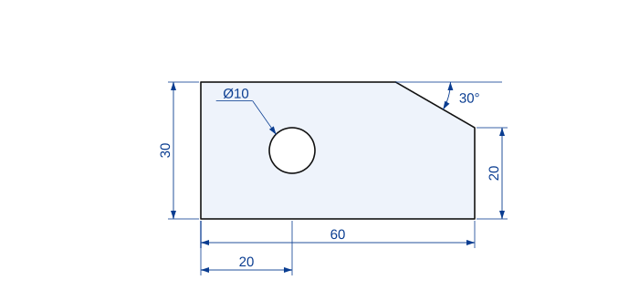

# Dimensions

Fix sizes and distances with numbers; the kind depends on what you select.

**Where:** Sketch toolbar → **Dimension** (++d++).

## When to use

Every sketch: the numbers from the robot drawings go in here.

## Main options

| Select | You get |
|---|---|
| One line | Length |
| Two points / point and line | Distance |
| Two parallel lines | Distance |
| Two lines at an angle | Angle |
| Circle / arc | Diameter / radius |
| Expression | `30 / 2`, `#t + 2`, `1 in` |

## Picture

## Common mistakes

- **Over-defined.** Something already fixes that size; find it instead of forcing it.
- **Dimension to a circle edge.** Dimension to the center, like the drawing.
- **Typed number instead of a variable.** If a size repeats, use a Variable.

## Used in

- [Lesson 1 · Sketch the outline](../../lesson-1.md#3-sketch-the-outline)
- [Lesson 2 · Dimensions](../../lesson-2.md#dimensions)

[Dimension](https://cad.onshape.com/help/Content/sketch-tools-dimension.htm){target=_blank}
