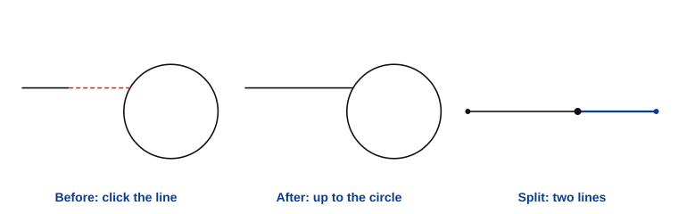

# Extend and Split

Extend lengthens a line or arc to the next curve; Split cuts it in two at a point.

**Where:** Sketch toolbar → **Extend** (++x++), **Split**.

## When to use

Fixing an outline that does not close; cutting a line so only one part of it gets a constraint.

## Main options

| Tool | What it does |
|---|---|
| **Extend** | Click near the end of a line: it grows until it hits the next curve |
| **Split** | Click a point on a curve: two curves, nothing removed |

## Picture

## Common mistakes

- **Nothing to hit.** Extend needs a curve in the way; otherwise draw a new line.
- **Using Split instead of Trim.** Split removes nothing.

## Used in

- [Lesson 2 · Editing tools](../../lesson-2.md#3-editing-tools)

[Extend](https://cad.onshape.com/help/Content/sketch-tools-extend.htm){target=_blank}
