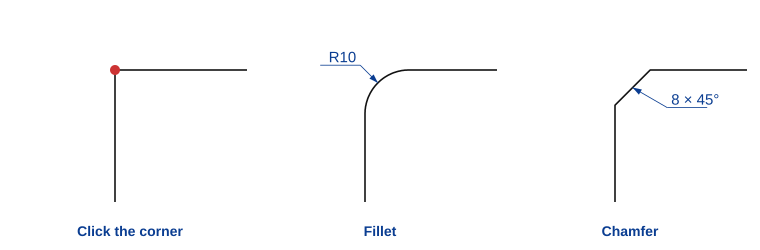

# Sketch fillet and chamfer

Rounds or cuts a corner of the sketch itself.

**Where:** Sketch toolbar → **Fillet**, **Chamfer**.

## When to use

Rounded windows in a wheel or a plate. A sketch fillet cannot break later, unlike a 3D fillet on edges that change.

## Main options

| Option | What it does |
|---|---|
| **Fillet** | Click the corner point, type the radius |
| **Chamfer** | Click the corner point, type the distance |

## Picture

## Common mistakes

- **Fillet bigger than the line.** Onshape refuses; use a smaller radius.
- **Fillet on the 3D part instead.** For pockets in a plate, a sketch fillet is simpler and safer.

## Used in

- [Lesson 2 · Editing tools](../../lesson-2.md#3-editing-tools)
- [T31](../../practice.md#t31)
- [T34](../../practice.md#t34)

[Sketch fillet](https://cad.onshape.com/help/Content/sketch-tools-fillet.htm){target=_blank}
