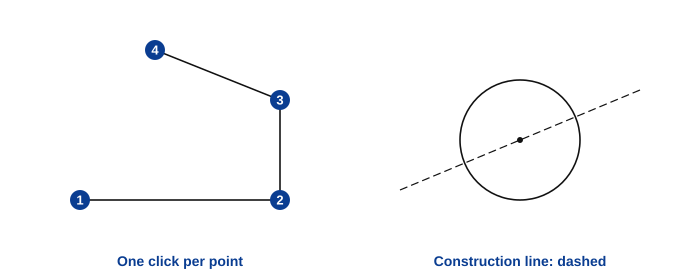

# Line

Draws straight lines, one click per point, as one chain.

**Where:** Sketch toolbar → **Line** (++l++).

## When to use

Any outline that is not a rectangle or a circle: a gusset, a bracket half. Construction lines are axes for Mirror and Symmetric.

## Main options

| Option | What it does |
|---|---|
| Click, click… | Each click adds a point; the lines are connected |
| Drag from an end | Starts a tangent arc instead of a line |
| ++esc++ or double-click | Ends the chain |
| **Construction** | A helper line: used by constraints, not by extrudes. Shown dashed |

## Picture

## Common mistakes

- **Lines not joined.** Start each line on the end of the last one, so they are coincident and the region closes.
- **Unwanted Horizontal / Vertical.** Inferencing added it; hold ++shift++ while drawing.
- **Axis drawn as a normal line.** It cuts the region in two. Make it Construction.

## Used in

- [Lesson 2 · Constraints](../../lesson-2.md#2-constraints-and-degrees-of-freedom)
- [Lesson 2 · Mirror: bracket](../../lesson-2.md#mirror-bracket)
- [T32](../../practice.md#t32)

[Sketch tools](https://cad.onshape.com/help/Content/sketch-tools.htm){target=_blank}
