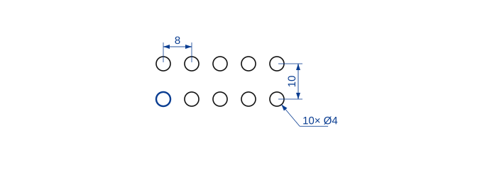

# Sketch linear pattern

Copies sketch geometry in a straight line, one or two directions.

**Where:** Sketch toolbar → **Linear pattern**.

## When to use

Rows of holes on the 8 mm grid inside one sketch.

## Main options

| Option | What it does |
|---|---|
| Entities | What to copy |
| Direction and distance | Spacing between copies |
| Count | Number of copies, the original included |
| Second direction | A grid |

## Picture

## Common mistakes

- **Distance is the total length.** It is the spacing between neighbours.
- **Count one too small.** The original counts.

## Used in

- [T26](../../practice.md#t26)
- [T29](../../practice.md#t29)
- [T32](../../practice.md#t32)
- [T33](../../practice.md#t33)
- [T34](../../practice.md#t34)

[Sketch pattern](https://cad.onshape.com/help/Content/sketch-tools-sketch-pattern.htm){target=_blank}
