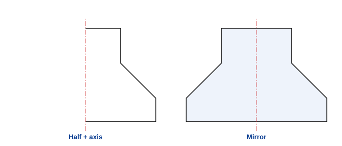

# Sketch mirror

Copies selected sketch geometry across a line.

**Where:** Sketch toolbar → **Mirror**.

## When to use

Symmetric plates: draw the right half of a side plate, mirror it about a construction line through the origin.

## Main options

| Option | What it does |
|---|---|
| Mirror line | Select it first: usually a construction line |
| Entities | Then select what to copy |
| Link | The copy follows the original |

## Picture

## Common mistakes

- **Mirror line is a normal line.** It splits the region; make it Construction.
- **Halves not joined.** End the half outline exactly on the mirror line.

## Used in

- [Lesson 2 · Mirror: bracket](../../lesson-2.md#mirror-bracket)
- [T26](../../practice.md#t26)
- [T32](../../practice.md#t32)

[Sketch mirror](https://cad.onshape.com/help/Content/sketch-tools-mirror.htm){target=_blank}
