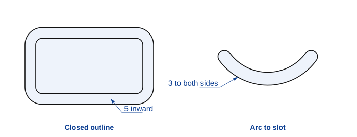

# Offset

Makes a copy of a chain of curves at a fixed distance.

**Where:** Sketch toolbar → **Offset**.

## When to use

Walls and frames: a pocket 5 mm inside the outline of a side plate. A curved slot: offset an arc to both sides.

## Main options

| Option | What it does |
|---|---|
| Distance | Gap between the original and the copy |
| Direction | Flip arrow, or **both sides** |
| Chain | Select one curve, the connected chain is used |

## Picture

## Common mistakes

- **Offset on the wrong side.** Flip the direction.
- **Corners overlap.** A distance larger than a corner radius breaks the copy; make the radius bigger or the distance smaller.

## Used in

- [Lesson 2 · Offset: frame](../../lesson-2.md#offset-frame)
- [L3-8](../../lesson-3.md#l38)

[Offset](https://cad.onshape.com/help/Content/sketch-tools-offset.htm){target=_blank}
