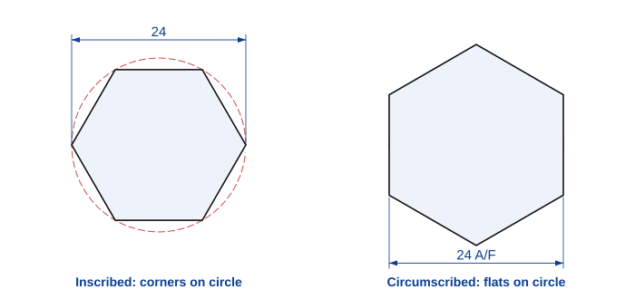

# Polygon

Draws a regular polygon with N equal sides.

**Where:** Sketch toolbar → **Polygon**.

## When to use

Hex shafts and hex bores, nut pockets, hex standoffs.

## Main options

| Option | What the circle means |
|---|---|
| **Inscribed** | Corners lie on the circle: Ø = across corners |
| **Circumscribed** | Sides touch the circle: Ø = across flats (A/F) |
| Number of sides | Set while drawing: 6 for a hex |

## Picture

## Common mistakes

- **Inscribed for a hex shaft.** A wrench and a shaft are sized across flats: use Circumscribed.
- **Polygon rotates.** Add Horizontal to one side.

## Used in

- [Lesson 2 · Hex nut](../../lesson-2.md#hex-nut)
- [T29](../../practice.md#t29)

[Sketch tools](https://cad.onshape.com/help/Content/sketch-tools.htm){target=_blank}
