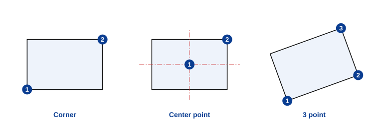

# Rectangle

Draws four lines that stay horizontal and vertical (or square to each other).

**Where:** Sketch toolbar → **Rectangle**.

## When to use

Base plates, cover plates, number plates. **Center point** for any part that is symmetric about the origin.

## Main options

| Option | How to draw |
|---|---|
| **Corner** | Two opposite corners |
| **Center point** | The center, then a corner. Symmetric about the center, no extra constraints |
| **3 point** | Two points along one edge, then the height. For tilted rectangles |

## Picture

## Common mistakes

- **Corner rectangle for a centered plate.** You then need two extra dimensions to the origin. Use Center point.
- **Center not on the origin.** Click exactly on the origin, or add Coincident.

## Used in

- [Lesson 1 · Sketch the outline](../../lesson-1.md#3-sketch-the-outline)
- [Lesson 2 · One shape, several ways](../../lesson-2.md#1-one-shape-several-ways-to-draw-it)

[Sketch tools](https://cad.onshape.com/help/Content/sketch-tools.htm){target=_blank}
