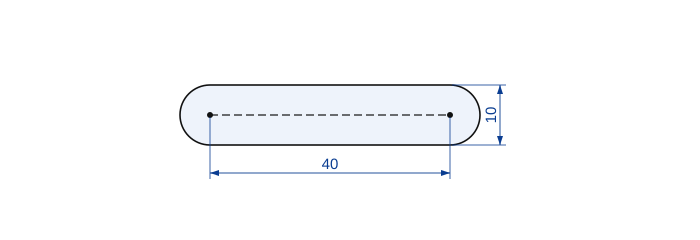

# Slot

Draws a slot with round ends around a line or arc.

**Where:** Sketch toolbar → **Slot**.

## When to use

Adjustment slots: a motor plate that slides to tension a belt, a camera mount that can tilt.

## Main options

| Option | What it does |
|---|---|
| **Straight** | Around a line: two end centers and the width |
| **Arc** | Along an arc |
| Width | Set by the second click or a dimension |

## Picture

## Common mistakes

- **Length dimension to the round ends.** Dimension between the end centers, the way the drawing does.
- **Width as a radius.** Dimension the width straight across.

## Used in

- [Lesson 2 · Slotted bar](../../lesson-2.md#slotted-bar-with-3-holes)

[Slot](https://cad.onshape.com/help/Content/sketch-tools-slot.htm){target=_blank}
