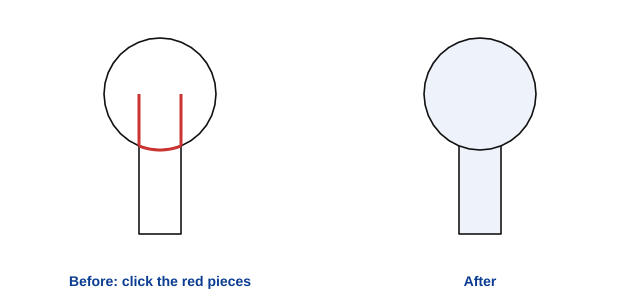

# Trim

Removes a piece of a sketch line or curve, up to the nearest intersections.

**Where:** Sketch toolbar → **Trim** (++m++).

## When to use

When two shapes overlap and you need one clean outline. Robot example: a keyhole slot in a plate. Draw a circle and a rectangle that overlap, then trim the pieces inside, and one closed region is left to extrude.

## Main options

| Action | Result |
|---|---|
| Click a piece | It is removed up to the nearest intersections |
| Drag across several pieces | Every piece the cursor touches is removed |
| Click a curve with no intersections | The whole curve is deleted |

## Picture

## Common mistakes

- **Region does not shade.** A trimmed outline has a gap or a short leftover piece. Zoom in on the corners: the closed region must be shaded before you extrude.
- **Constraints are gone.** Dimensions and constraints on the removed piece are deleted with it. Check that the sketch is still black.
- **Trim instead of a better tool.** A slot is faster with **Slot**, a rounded corner with sketch **Fillet**. Trim is for shapes no single tool draws.

## Used in

- [Lesson 2 · Editing tools](../../lesson-2.md#3-editing-tools)
- [T33 · Keyhole plate](../../practice.md#t33)

[Onshape help: Trim](https://cad.onshape.com/help/Content/sketch-tools-trim.htm){target=_blank}
